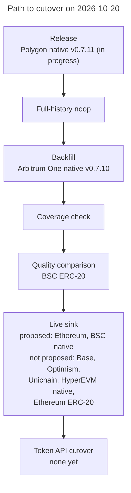
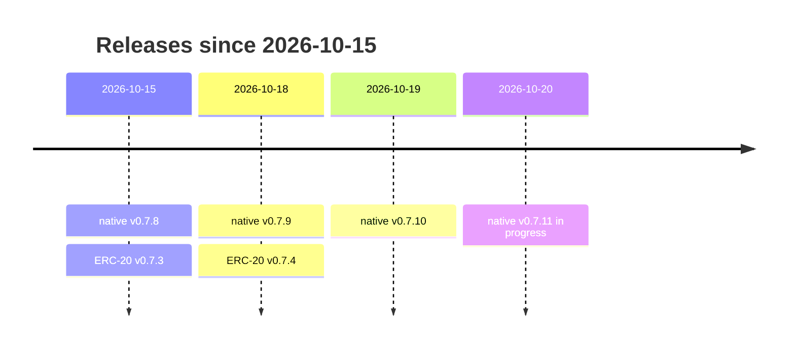
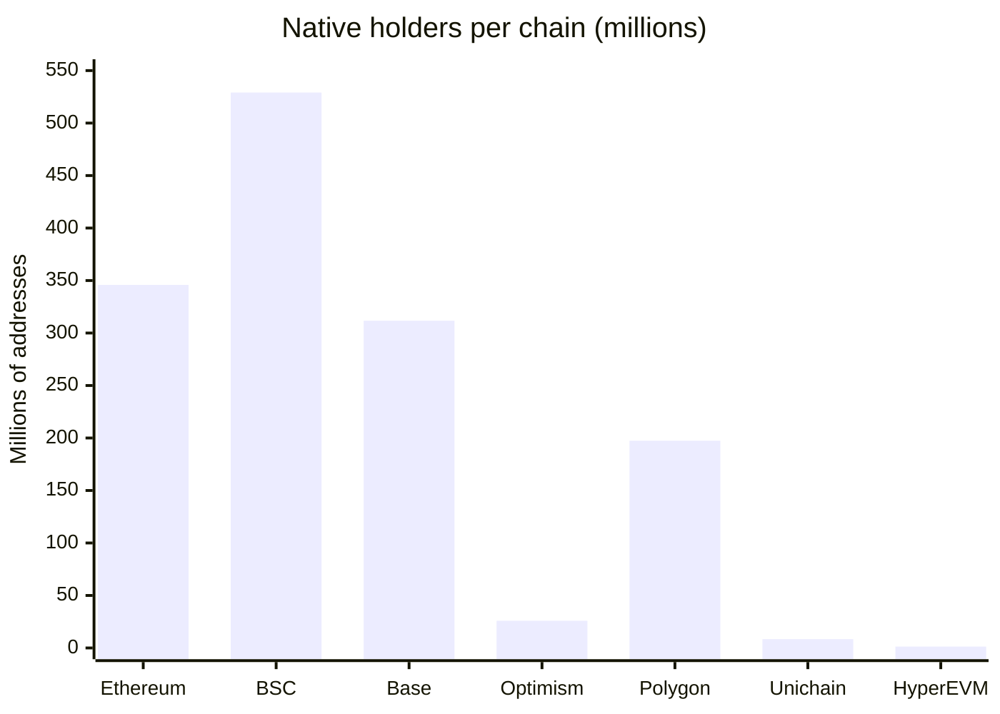
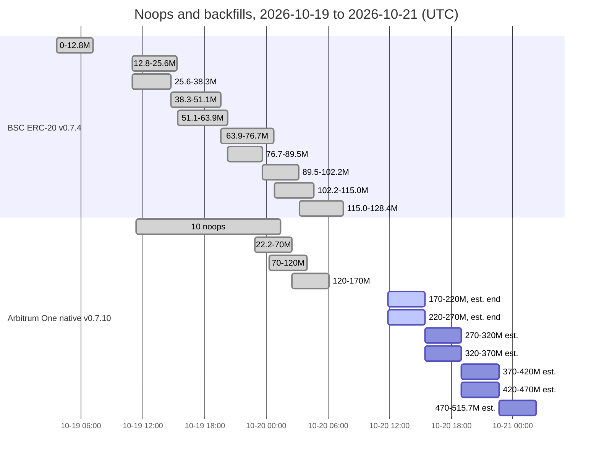

# Token API balances: deployment status

## Status board

| Chain | Native | ERC-20 | Live sink | Note |
| --- | --- | --- | --- | --- |
| Ethereum | ✅ v0.7.8 | ✅ v0.7.4 | ⏳ native proposed | |
| BSC | ✅ v0.7.8 | ✅ v0.7.4 | ⏳ native proposed | 🔄 [ERC-20 comparison](#bsc-erc-20-comparison) |
| Base | ✅ v0.7.9 | ⛔ | not proposed | |
| Optimism | ✅ v0.7.8 | ⛔ | not proposed | ⚠️ [legacy state](#before-the-cutover) to seed |
| Polygon | ✅ v0.7.8 | ⛔ | after resync | ⚠️ over-count, 🛠️ [v0.7.11](#polygon-native-v0711) fix and resync |
| Unichain | ✅ v0.7.8 | ⛔ | not proposed | |
| HyperEVM | ✅ v0.7.8 | ⛔ | not proposed | |
| Arbitrum One | 🔄 v0.7.10 | ⛔ | after backfill | 🔄 [backfilling](#arbitrum-one-native-v0710), ⚠️ legacy state to seed |
| Avalanche | ⛔ | ⛔ | | [no Extended blocks](#what-the-token-api-serves-today) |

Legend: ✅ done (backfilled) · 🔄 running · ⏳ queued or awaiting the owner ·
⚠️ issue · 🛠️ fix in progress · ⛔ not scheduled. "Live sink" is the live
sink of the new database; none runs yet.

> [!NOTE]
> A snapshot taken on 2026-10-20 at about 14:00 UTC. The rows here change as
> backfills finish. [Handoff](handoff.md) keeps the current state.

For each chain, this page lists the final package release, the ClickHouse
database it writes, what is backfilled, and what is still running. The
quality comparisons with the RPC-era databases are on separate pages:

- [Native balance quality](quality-native.md), for the seven chains whose
  native database is fully backfilled.
- [ERC-20 balance quality](quality-erc20.md), for Ethereum. The BSC ERC-20
  database completed on 2026-10-20, and its comparison is
  [in progress](#bsc-erc-20-comparison).
- [Top tokens](quality-top-tokens.md): USDT, USDC and WETH on Ethereum, and
  the wrapped native token of every chain (WETH, WBNB, WPOL, WHYPE).
- [Methods](quality-methods.md): how the comparisons work, with the SQL to
  rerun them.

## Quality at a glance

- **Native balances agree with the RPC era for 99.1% (Ethereum) to 100%
  (Unichain) of the addresses compared.** Nearly every difference is an
  RPC-era error: on Ethereum, its live sink stored pre-block balances for
  about 3.06 million addresses in February 2026. On BSC it never wrote 1,629
  blocks of 2024-01-18, and on HyperEVM it missed internal transfers.
- **ERC-20 on Ethereum covers 62% of the RPC era's non-zero holder pairs,
  and 99.26% of its own rows are equal.** Ordinary tokens are accurate (99.996%
  of holders). Airdrop spam, computed balances (stETH, aTokens, reflection)
  and balances kept elsewhere (MiniMe, Synthetix) are not served, and some
  real tokens are stale (MKR, HEX, TUSD). See
  [ERC-20 quality](quality-erc20.md).
- **USDT, USDC and WETH match the RPC era for more than 99.99% of non-zero
  holders, and their supplies close.** Apart from the zero address, which the
  package never emits, each has at most a dozen wrong holders. See
  [top tokens](quality-top-tokens.md).
- **The new native databases have four known gaps**, in the table below. See
  [native quality](quality-native.md#gaps-in-the-new-databases).

| Chain | Known gap in the new native database | Extent |
| --- | --- | --- |
| Polygon | [Misses some self-destruct debits](quality-native.md#polygon-missed-self-destruct-debits), which its producer leaves unmarked; fix v0.7.11 [in progress](#polygon-native-v0711) | at least 1,831.73 POL over-counted |
| Optimism | [Lacks balances unchanged since Bedrock](quality-native.md#optimism-balances-not-changed-since-bedrock) | at least 411,978 addresses, about 501 ETH |
| Ethereum | [72 contracts keep ETH](quality-native.md#ethereum-credits-of-contracts-created-in-the-transaction) | 0.00153 ETH |
| Unichain | [Three early credits are missing from the history](quality-native.md#unichain-three-early-credits-missing-from-the-history) | three credits |

## Path to cutover

Each database passes these stages in order; the second line of a box names
the chains at that stage.

## Final releases

**No release is live-qualified yet** (see [Handoff](handoff.md)).

Release dates of the native and ERC-20 packages since 2026-10-15. ERC-20
v0.7.4 replaced v0.7.3 ([superseded databases](#superseded-databases)).

The native package is `evm_balances_native` and the ERC-20 package
`evm_balances_erc20`. The table shows the first 8 characters of each module
hash; the full hashes are right below it.

| Release tag | `map_events` | `db_out` | Chains |
| --- | --- | --- | --- |
| [`evm-balances-native-v0.7.8`](https://github.com/pinax-network/substreams-evm-balances/releases/tag/evm-balances-native-v0.7.8) | `6ed24645` | `40f294cb` | Ethereum, BSC, Polygon, Optimism, Unichain, HyperEVM |
| [`evm-balances-native-v0.7.9`](https://github.com/pinax-network/substreams-evm-balances/releases/tag/evm-balances-native-v0.7.9) | `424ce160` | `9cf8c500` | Base |
| [`evm-balances-native-v0.7.10`](https://github.com/pinax-network/substreams-evm-balances/releases/tag/evm-balances-native-v0.7.10) | `ee871813` | `5feb4830` | Arbitrum One |
| [`evm-balances-erc20-v0.7.4`](https://github.com/pinax-network/substreams-evm-balances/releases/tag/evm-balances-erc20-v0.7.4) | `e611c63a` | `0786f2df` | Ethereum, BSC |

Full module hashes

| Package | Module | Hash |
| --- | --- | --- |
| `evm_balances_native` v0.7.8 | `map_events` | `6ed2464534915064dd4f475e80d453b709fd7727` |
| | `db_out` | `40f294cb126dae6dbbd874f9e291e85b634d04d1` |
| `evm_balances_native` v0.7.9 | `map_events` | `424ce160682cf8c429d18322fbc23bf91fdd8a5c` |
| | `db_out` | `9cf8c500a73dd95f91112d1c71fe4fe7e964334f` |
| `evm_balances_native` v0.7.10 | `map_events` | `ee871813ce0ebe99dc94d57d3975cb0b45e75095` |
| | `db_out` | `5feb4830c806c568cc9df46b8f280b618cc2b51b` |
| `evm_balances_erc20` v0.7.4 | `map_events` | `e611c63aab92c691fbb32550fa008faab113f194` |
| | `db_out` | `0786f2dffd4c82b9fa011988e6b9b6a18ca4b51b` |

Each spkg is the release asset
`https://github.com/pinax-network/substreams-evm-balances/releases/download/<tag>/<tag>.spkg`.
The hashes above were read with `substreams info` from the published assets.

One native database per chain is enough. The native versions differ only in
which producer shapes they accept. v0.7.9 and v0.7.10 accept blocks that
v0.7.8 refused on Arbitrum One and Base, and give v0.7.8's output for every
block v0.7.8 accepts. So a chain moves to a newer version only when its
full-history noop needs it. v0.7.11, in progress, is the first to change the
output of blocks that earlier versions accept: it adds the debits of
unmarked Polygon self-destructs ([below](#polygon-native-v0711)).

## Databases per chain

Each new database is backfilled from the chain's first Extended block to a
fixed end block. That end block is the start block of its future live sink.
"Blocks" counts blocks with at least one balance change; blocks without one
have no row. "Holders" counts distinct addresses for native and distinct
(contract, holder) pairs for ERC-20, including rows whose balance is now
zero.

### Native databases

| Chain | Native database | Backfilled range | Blocks | Holders |
| --- | --- | --- | ---: | ---: |
| Ethereum | `mainnet:evm-balances-native@v0.7.8` | [0, 26,198,000) | 26,195,986 | 345,811,875 |
| BSC | `bsc:evm-balances-native@v0.7.8` | [0, 127,810,000) | 127,199,156 | 529,074,089 |
| Base | `base:evm-balances-native@v0.7.9` | [0, 52,720,000) | 50,867,566 | 311,651,644 |
| Optimism | `optimism:evm-balances-native@v0.7.8` | [105,236,000, 158,320,000) | 52,714,811 | 25,933,707 |
| Polygon | `polygon:evm-balances-native@v0.7.8` | [0, 95,690,000) | 86,915,716 | 197,432,321 |
| Unichain | `unichain:evm-balances-native@v0.7.8` | [0, 61,490,000) | 52,934,210 | 8,385,130 |
| HyperEVM | `hyperevm:evm-balances-native@v0.7.8` | [0, 48,780,000) | 43,413,402 | 1,254,132 |
| Arbitrum One | `arbitrum-one:evm-balances-native@v0.7.10` | 🔄 backfilling over [22,208,000, 515,680,000) ([below](#arbitrum-one-native-v0710)) | | |

Distinct addresses in each backfilled native database, in millions (rounded;
the exact counts are in the table above). Optimism counts only since Bedrock.

### ERC-20 databases

Only Ethereum and BSC have an ERC-20 database; every other chain has none
([not scheduled](#not-scheduled)).

| | Ethereum | BSC |
| --- | ---: | ---: |
| ERC-20 database | `mainnet:evm-balances-erc20@v0.7.4` | `bsc:evm-balances-erc20@v0.7.4` |
| Backfilled range | [0, 26,215,000) | [0, 128,355,000) |
| Blocks | 22,268,024 | 127,446,295 |
| Holders (pairs) | 443,936,986 | 1,667,606,356 |
| In contracts | 1,428,012 | 11,725,063 |

### Coverage checks

Every database listed as backfilled was checked the same way, and every check
passed. Its `backfill_processed_ranges` cover the range with no break and no
duplicate, and its `blocks` table has one row per block. A block has no row
when nothing in it changed a balance. The native databases were also checked
against the RPC-era transfer databases, `<chain>:evm-transfers@v0.3.3`: no
block that carries a native value transfer there
(`native_transfers.amount > 0`) is missing from the native database.

Blocks without a row, per native database

| Chain | Blocks in range | Blocks without a row | Blocks with a native value transfer | Of those, missing from native |
| --- | ---: | ---: | ---: | ---: |
| Ethereum | 26,198,000 | 2,014 | 26,190,111 | 0 |
| BSC | 127,810,000 | 610,844 | 127,199,155 | 0 |
| Base | 52,720,000 | 1,852,434 | 50,227,257 | 0 |
| Optimism | 53,084,000 | 369,189 | 45,006,232 | 0 |
| Polygon | 95,690,000 | 8,774,284 | 80,933,100 | 0 |
| Unichain | 61,490,000 | 8,555,790 | 23,414,041 | 0 |
| HyperEVM | 48,780,000 | 5,366,598 | 14,378,421 | 0 |

On Ethereum, the blocks without a row are empty blocks between the Merge and
Shanghai, which carry no reward. On Base, 1.72M of them are below block
2,000,000, before Base opened to users. On the L2s and Polygon, a block can
hold only system transactions, which pay no fee.

Optimism starts at Bedrock and Arbitrum One at Nitro, at the first whole
1,000-block segment of Extended blocks. The legacy chains' balances appear in
no block's records, so an account that has not changed since then has no
row ([start blocks](../native/balances/README.md#input-and-networks)).

### What the Token API serves today

The Token API still reads the RPC-era databases, `<chain>:evm-balances@v0.3.3`.
Each was backfilled up to the block below and is kept at the chain head by a
live sink. All comparisons on the quality pages are against these databases.

| Chain | RPC-era database | Backfilled to, then live | Head on 2026-10-19 ~15:20 UTC |
| --- | --- | ---: | ---: |
| Ethereum | `mainnet:evm-balances@v0.3.3` | 24,420,000 | 26,227,474 |
| BSC | `bsc:evm-balances@v0.3.3` | 81,390,000 | 128,575,312 |
| Base | `base:evm-balances@v0.3.3` | 42,090,000 | 52,816,917 |
| Optimism | `optimism:evm-balances@v0.3.3` | 147,920,000 | 158,412,211 |
| Polygon | `polygon:evm-balances@v0.3.3` | 83,060,000 | 95,811,900 |
| Unichain | `unichain:evm-balances@v0.3.3` | 40,180,000 | 61,674,842 |
| HyperEVM | `hyperevm:evm-balances@v0.3.3` | 35,000,000 | 48,969,310 |
| Arbitrum One | `arbitrum-one:evm-balances@v0.3.3` | 433,100,000 | 516,324,009 |
| Avalanche | `avalanche:evm-balances@v0.3.4` | not compared | |

Avalanche stays on the RPC-era package. Its endpoint serves no Extended
blocks, so both new packages refuse every block there.

## Live sinks

None of the new databases has a live sink yet. Each one stops at its
backfill's end block, which is the start block of its future live sink. When
a sink starts, it catches up from that block to the head. The
[cutover](clickhouse.md) then points the Token API's `balances-native` and
`balances-erc20` keys at the new databases, one chain and one side at a time.

| Chain | Native live sink start | ERC-20 live sink start | Live sink deployment |
| --- | ---: | ---: | --- |
| Ethereum | 26,198,000 | 26,215,000 | ⏳ native proposed (awaiting the owner); ERC-20 not proposed yet |
| BSC | 127,810,000 | 128,355,000 | ⏳ native proposed (awaiting the owner); ERC-20 not proposed yet |
| Base | 52,720,000 | | not proposed yet |
| Optimism | 158,320,000 | | not proposed yet |
| Polygon | 95,690,000 | | after the v0.7.11 resync ([below](#polygon-native-v0711)) |
| Unichain | 61,490,000 | | not proposed yet |
| HyperEVM | 48,780,000 | | not proposed yet |
| Arbitrum One | 515,680,000 | | after its backfill |

### Before the cutover

> [!IMPORTANT]
> Settle these four points before the cutover:
>
> - **Seed the legacy state on Optimism and Arbitrum One.** Their databases
>   start at Bedrock and Nitro, so balances unchanged since then have no row
>   ([native quality](quality-native.md#optimism-balances-not-changed-since-bedrock)).
> - **Polygon's missed self-destruct debits** need the v0.7.11 fix and a resync
>   ([below](#polygon-native-v0711),
>   [native quality](quality-native.md#polygon-missed-self-destruct-debits)).
> - **The new schema creates fewer objects than the RPC-era databases have.**
>   Those also hold 1, 5, 10 and 30-minute bars (the new history keeps 1h, 4h,
>   1d and 1w), the `native_balances_holders` and `erc20_balances_holders`
>   views (top 1,000 holders, per contract for ERC-20), and
>   `native_balances_is_deleted` and `native_balances_year_is_deleted`. Check
>   which of them the Token API reads.
> - **ERC-20 holders the package never emits.** The zero address, and the token
>   kinds listed in [ERC-20 quality](quality-erc20.md#tokens-the-new-database-does-not-serve).

## In progress

Backfill ranges of BSC ERC-20 v0.7.4 (done) and Arbitrum One native v0.7.10
(done, running, and queued with estimated times), in millions of blocks, and
the Arbitrum One full-history noops (one bar). The exact ranges and times are
in the tables below.

### Polygon native v0.7.11

> [!WARNING]
> The [native quality page](quality-native.md#polygon-missed-self-destruct-debits)
> found that `polygon:evm-balances-native@v0.7.8` keeps the balance of
> contracts that self-destructed: 61 contracts and 1,694.17 POL found by the
> comparison, and at least 1,831.73 POL over-counted by the supply check.

On 2026-10-20 the 61 blocks showed the cause. After Polygon's Napoli fork,
the producer leaves these self-destructs unmarked (no `suicide` flag) and
records only the beneficiary's credit, so v0.7.8 never restores the
contract's debit.

- Fix: native v0.7.11 restores the debit in that exact shape. The patch, with
  captured fixtures and tests, is being written and reviewed; an offline
  replay of the 61 blocks checks it.
- Unlike v0.7.9 and v0.7.10, it changes the output of blocks that v0.7.8
  accepts. A survey of the saved blocks of the other chains checks whether
  the shape occurs outside Polygon. If it does not, only Polygon resyncs.
- Next, each with the owner's OK: the pre-release noop and the release, then
  Polygon's full-history noop and its resync into
  `polygon:evm-balances-native@v0.7.11`.

### Arbitrum One native v0.7.10

Three of the ten backfill ranges are done and two are running. A range takes
about 3.6 hours, so the database should be complete early on 2026-10-21 UTC
(an estimate).

The full-history noop of native v0.7.9 refused block 500,689,520 on
2026-10-18. v0.7.10 accepts it, and at the owner's direction Arbitrum One
resyncs into `arbitrum-one:evm-balances-native@v0.7.10`. All 10 full-history
noops over [22,208,000, 515,680,000) passed by 2026-10-20 01:25 UTC, with no
refusal (they ran from 2026-10-19 11:22 UTC). The backfills run in ascending
ranges of 50M blocks, two at a time; five ranges, [270,000,000,
515,680,000), are queued.

| Range | State | Start (UTC) | End (UTC) |
| --- | --- | --- | --- |
| [22,208,000, 70,000,000) | ✅ done | 2026-10-19 22:53 | 2026-10-20 02:30 |
| [70,000,000, 120,000,000) | ✅ done | 2026-10-20 00:15 | 2026-10-20 03:58 |
| [120,000,000, 170,000,000) | ✅ done | 2026-10-20 02:31 | 2026-10-20 06:07 |
| [170,000,000, 220,000,000) | 🔄 running | 2026-10-20 11:49 | 15:25, est. |
| [220,000,000, 270,000,000) | 🔄 running | 2026-10-20 11:49 | 15:25, est. |
| [270,000,000, 320,000,000) | ⏳ queued | 15:25, est. | 19:00, est. |
| [320,000,000, 370,000,000) | ⏳ queued | 15:25, est. | 19:00, est. |
| [370,000,000, 420,000,000) | ⏳ queued | 19:00, est. | 22:40, est. |
| [420,000,000, 470,000,000) | ⏳ queued | 19:00, est. | 22:40, est. |
| [470,000,000, 515,680,000) | ⏳ queued | 22:40, est. | 2026-10-21 02:15, est. |

The partial `arbitrum-one:evm-balances-native@v0.7.9`, [22,208,000,
220,000,000), is superseded. Dropping it needs the owner's OK.

### BSC ERC-20 comparison

The BSC ERC-20 v0.7.4 database is complete, and its comparison is running.
The backfill completed on 2026-10-20 at 07:29 UTC: all 10 full-history noops
passed, and the 10 backfills cover [0, 128,355,000) in 1,286 contiguous
ranges. Its comparison with the RPC-era database (USDT, USDC, WBNB, the 100
most-held contracts and the overall coverage) started at about 13:20 UTC.
The results will go on the [ERC-20](quality-erc20.md) and
[top-token](quality-top-tokens.md) pages. The top-token page already checks
WBNB against the native database.

The 10 backfill ranges and their times

| Range | Start (UTC) | End (UTC) |
| --- | --- | --- |
| [0, 12,781,000) | 2026-10-19 03:37 | 2026-10-19 07:10 |
| [12,781,000, 25,562,000) | 2026-10-19 10:58 | 2026-10-19 15:20 |
| [25,562,000, 38,343,000) | 2026-10-19 10:59 | 2026-10-19 14:42 |
| [38,343,000, 51,124,000) | 2026-10-19 14:43 | 2026-10-19 19:36 |
| [51,124,000, 63,905,000) | 2026-10-19 15:21 | 2026-10-19 20:15 |
| [63,905,000, 76,686,000) | 2026-10-19 19:36 | 2026-10-20 00:45 |
| [76,686,000, 89,467,000) | 2026-10-19 20:16 | 2026-10-19 23:37 |
| [89,467,000, 102,248,000) | 2026-10-19 23:39 | 2026-10-20 03:09 |
| [102,248,000, 115,029,000) | 2026-10-20 00:46 | 2026-10-20 04:39 |
| [115,029,000, 128,355,000) | 2026-10-20 03:12 | 2026-10-20 07:29 |

### Superseded databases

Three databases are replaced, and dropping each needs the owner's OK.

Superseded databases and their replacements

| Database | Replaced by |
| --- | --- |
| `mainnet:evm-balances-erc20@v0.7.3` | `mainnet:evm-balances-erc20@v0.7.4` |
| `bsc:evm-balances-erc20@v0.7.3` | `bsc:evm-balances-erc20@v0.7.4` |
| `arbitrum-one:evm-balances-native@v0.7.9` (partial) | `arbitrum-one:evm-balances-native@v0.7.10` |

### Not scheduled

- ERC-20 on Base, Optimism, Polygon, Unichain, HyperEVM and Arbitrum One. The
  owner extended only the native package to these chains (2026-10-17), so the
  Token API keeps the RPC-era ERC-20 balances there.
- Avalanche ([above](#what-the-token-api-serves-today)).
