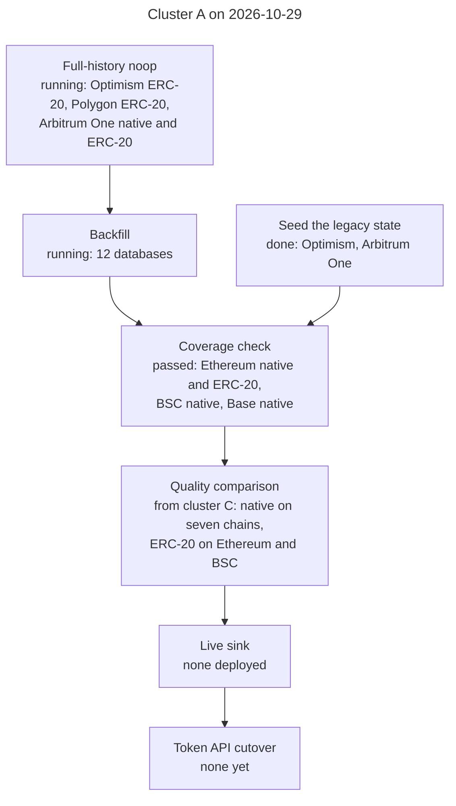
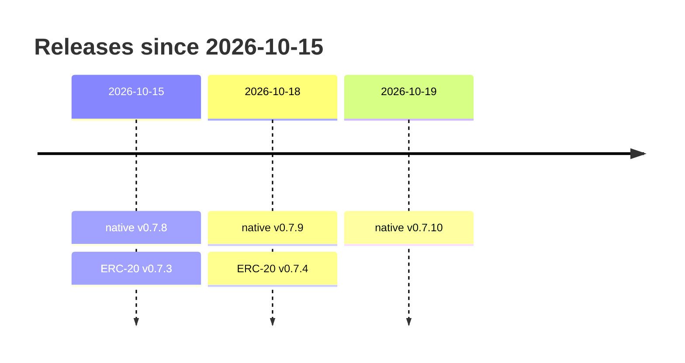
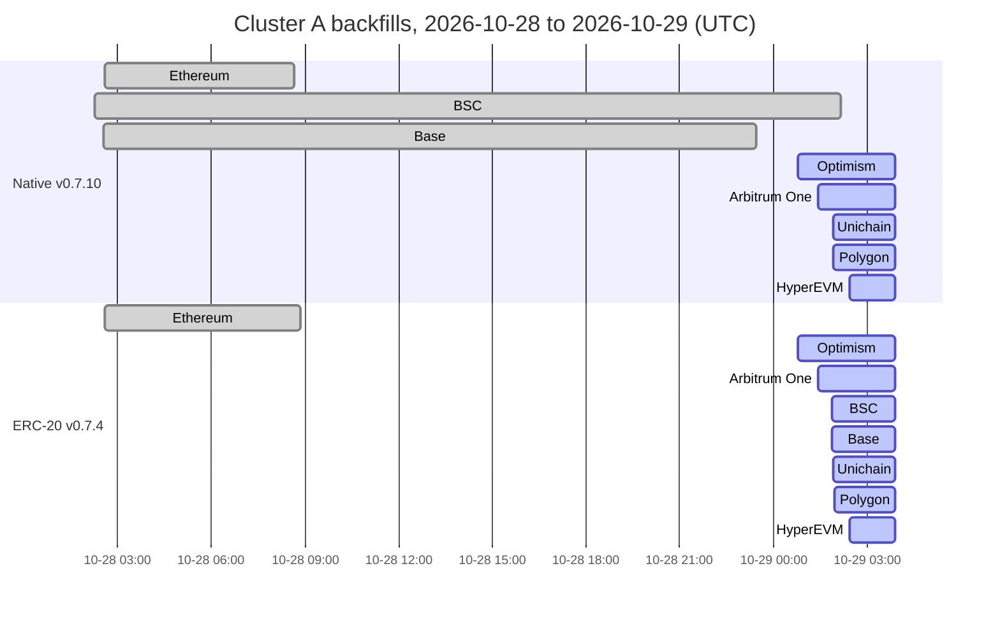
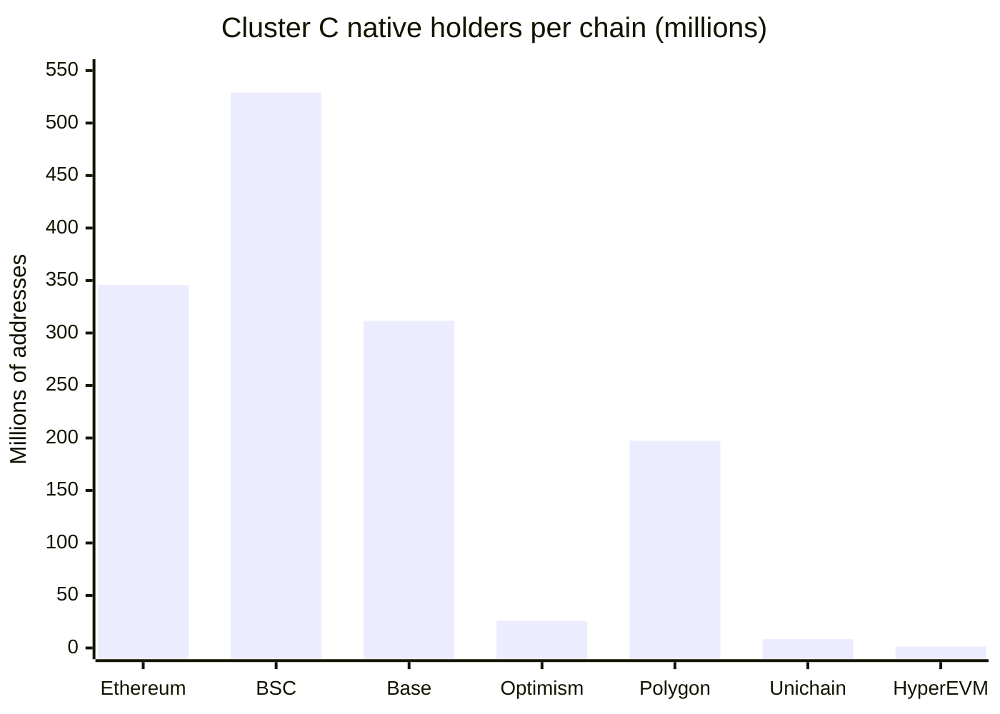

# Token API balances: deployment status

## Status board

The Token API's new balances databases are in ClickHouse cluster A. Every
chain resyncs there with native v0.7.10 and ERC-20 v0.7.4. No live sink
writes cluster A yet.

| Chain | Native v0.7.10 | ERC-20 v0.7.4 | Note |
| --- | --- | --- | --- |
| Ethereum | ✅ | ✅ | ⚠️ [known deletion defect](#before-the-cutover) |
| BSC | ✅ | 🔄 5.6% | |
| Base | ✅ | 🔄 32.5% | |
| Optimism | 🔄 99.7% | 🔄 78.5% | ✅ [pre-Bedrock state seeded](#legacy-state-below-the-extended-start) |
| Polygon | 🔄 24.9% | 🔄 25.4% | ⚠️ [over-count](#polygon-native-v0711), v0.7.11 fix; resync pending |
| Unichain | 🔄 86.5% | 🔄 57.3% | |
| HyperEVM | 🔄 44.1% | 🔄 44.7% | |
| Arbitrum One | 🔄 38.1% | 🔄 24.5% | ✅ [pre-Nitro state seeded](#legacy-state-below-the-extended-start) |
| Avalanche | ⛔ | ⛔ | [no Extended blocks](#what-the-token-api-serves-today), stays on the RPC era in cluster C |

Legend: ✅ backfilled and coverage-checked · 🔄 backfilling, with the share
of the range done · ⚠️ issue · ⛔ not scheduled.

> [!NOTE]
> Cluster A snapshot of 2026-10-29 03:54 UTC. The quality comparisons and
> the [cluster C](#cluster-c) sections keep their own dates. This page before
> cluster A is at
> [`5622fdb`](https://github.com/pinax-network/substreams-evm-balances/blob/5622fdb/docs/deployment-status.md).

For each chain, this page lists the package release, the ClickHouse database
it writes, what is backfilled, and what is still running. The quality
comparisons with the RPC-era databases are on separate pages:

- [Native balance quality](quality-native.md), for the seven chains whose
  native database was fully backfilled in cluster C.
- [ERC-20 balance quality](quality-erc20.md), for Ethereum and BSC.
- [Top tokens](quality-top-tokens.md): USDT, USDC and WETH on Ethereum,
  USDT, USDC and WBNB on BSC, and the wrapped native token of every chain
  (WETH, WBNB, WPOL, WHYPE).
- [Methods](quality-methods.md): how the comparisons work, with the SQL to
  rerun them.

## Clusters

Two ClickHouse clusters hold the balances databases. Each has one shard
and two replicas.

| Cluster | ClickHouse cluster | Databases | Live sinks |
| --- | --- | --- | --- |
| A | `tokenapis-a` | The new databases the Token API will read: native v0.7.10 and ERC-20 v0.7.4 on all eight chains | none yet |
| C | `tokenapis-c` | The RPC-era databases the Token API serves today, and the first new databases, which the quality pages compared | RPC-era sinks of every chain; Ethereum and BSC native v0.7.8 since 2026-10-23 |

Argo workflows from the `token-backfill-prod-a` template backfill cluster A.
They run on `riv-dev1`, in namespace `token-api-workflows`, with
substreams-sink-sql v4.13.0. Each workflow splits its range into jobs of a
fixed size and runs ten at a time. A job keeps its cursor in its own
`backfill_<start>` table, which is dropped when the job finishes. The
finished ranges are kept in `backfill_processed_ranges`. Every workflow runs
with `deploy-live-sink=false`, so the live sinks are started separately.

## Quality at a glance

The comparisons ran on the cluster C databases on 2026-10-20. Native v0.7.10
gives v0.7.8's output for every block that v0.7.8 accepts, and ERC-20 is
the same v0.7.4. So the findings hold for cluster A over the same blocks,
apart from the Optimism gap that the seed closes ([below](#known-gaps)). The
ERC-20 databases of Base, Optimism, Polygon, Unichain, HyperEVM and Arbitrum
One have not been compared yet.

- **Native balances agree with the RPC era for 99.1% (Ethereum) to 100%
  (Unichain) of the addresses compared.** Nearly every difference is an
  RPC-era error. On Ethereum, its live sink stored pre-block balances for
  about 3.06 million addresses in February 2026. On BSC it never wrote 1,629
  blocks of 2024-01-18, and on HyperEVM it missed internal transfers.
- **ERC-20 covers 62% (Ethereum) and 45% (BSC) of the RPC era's non-zero
  holder pairs, and 99.26% and 99.39% of its own non-zero rows are equal.**
  Ordinary tokens are accurate (99.996% of holders on Ethereum, 99.999% on
  BSC). Airdrop spam, computed balances (stETH, aTokens, reflection) and
  balances kept elsewhere (MiniMe, Synthetix) are not served, and some real
  tokens are stale (MKR, HEX, TUSD). See [ERC-20 quality](quality-erc20.md).
- **USDT, USDC and WETH (Ethereum) and USDT, USDC and WBNB (BSC) match the
  RPC era for more than 99.99% of non-zero holders, and their supplies
  close.** Apart from the zero address, which the package never emits, each
  has at most a dozen wrong holders. On BSC, USDT and USDC have none and
  WBNB has 2. See [top tokens](quality-top-tokens.md).
- **The native databases have four known gaps**, in the table below. See
  [native quality](quality-native.md#gaps-in-the-new-databases).

### Known gaps

| Chain | Known gap in the cluster C native database | Extent | In cluster A |
| --- | --- | --- | --- |
| Polygon | [Misses some self-destruct debits](quality-native.md#polygon-missed-self-destruct-debits), which its producer leaves unmarked; fix in [v0.7.11](#polygon-native-v0711), resync pending | at least 1,831.73 POL over-counted | the same, v0.7.10 |
| Optimism | [Lacks balances unchanged since Bedrock](quality-native.md#optimism-balances-not-changed-since-bedrock) | at least 411,978 addresses, about 501 ETH | [seeded](#legacy-state-below-the-extended-start) from the RPC era |
| Ethereum | [72 contracts keep ETH](quality-native.md#ethereum-credits-of-contracts-created-in-the-transaction) | 0.00153 ETH | the same |
| Unichain | [Three early credits are missing from the history](quality-native.md#unichain-three-early-credits-missing-from-the-history) | three credits | the same |

## Path to cutover

Each database passes these stages in order. The second line of a box names
the chains at that stage. Optimism and Arbitrum One also take the RPC-era
state below their start blocks.

## Final releases

The native package is `evm_balances_native` and the ERC-20 package
`evm_balances_erc20`. The table shows the first 8 characters of each module
hash. The full hashes are right below it.

| Release tag | `map_events` | `db_out` | Cluster A | Cluster C |
| --- | --- | --- | --- | --- |
| [`evm-balances-native-v0.7.8`](https://github.com/pinax-network/substreams-evm-balances/releases/tag/evm-balances-native-v0.7.8) | `6ed24645` | `40f294cb` | | Ethereum, BSC, Polygon, Optimism, Unichain, HyperEVM |
| [`evm-balances-native-v0.7.9`](https://github.com/pinax-network/substreams-evm-balances/releases/tag/evm-balances-native-v0.7.9) | `424ce160` | `9cf8c500` | | Base |
| [`evm-balances-native-v0.7.10`](https://github.com/pinax-network/substreams-evm-balances/releases/tag/evm-balances-native-v0.7.10) | `ee871813` | `5feb4830` | all eight chains | Arbitrum One (partial) |
| [`evm-balances-erc20-v0.7.4`](https://github.com/pinax-network/substreams-evm-balances/releases/tag/evm-balances-erc20-v0.7.4) | `e611c63a` | `0786f2df` | all eight chains | Ethereum, BSC |

Release dates of the native and ERC-20 packages since 2026-10-15. ERC-20
v0.7.4 replaced v0.7.3 ([superseded databases](#superseded-databases)).

Full module hashes

| Package | Module | Hash |
| --- | --- | --- |
| `evm_balances_native` v0.7.8 | `map_events` | `6ed2464534915064dd4f475e80d453b709fd7727` |
| | `db_out` | `40f294cb126dae6dbbd874f9e291e85b634d04d1` |
| `evm_balances_native` v0.7.9 | `map_events` | `424ce160682cf8c429d18322fbc23bf91fdd8a5c` |
| | `db_out` | `9cf8c500a73dd95f91112d1c71fe4fe7e964334f` |
| `evm_balances_native` v0.7.10 | `map_events` | `ee871813ce0ebe99dc94d57d3975cb0b45e75095` |
| | `db_out` | `5feb4830c806c568cc9df46b8f280b618cc2b51b` |
| `evm_balances_erc20` v0.7.4 | `map_events` | `e611c63aab92c691fbb32550fa008faab113f194` |
| | `db_out` | `0786f2dffd4c82b9fa011988e6b9b6a18ca4b51b` |

Each spkg is the release asset
`https://github.com/pinax-network/substreams-evm-balances/releases/download/<tag>/<tag>.spkg`.
The hashes above were read with `substreams info` from the published assets.
The cluster A workflows stream these assets.

From v0.7.8 to v0.7.10 the native versions differ only in which producer
shapes they accept. v0.7.9 and v0.7.10 accept blocks that v0.7.8 refused on
Arbitrum One and Base, and give v0.7.8's output for every block v0.7.8
accepts. So cluster A runs v0.7.10 on every chain. v0.7.11, not released
yet, is the first since v0.7.8 to change the output of blocks that earlier
versions accept, and the first since v0.7.8 that can refuse such blocks:
it adds the debits of unmarked Polygon self-destructs, and refuses a call
without the mark that holds a self-destruct credit in any other shape but
a self-destruct to itself. Such a self-destruct was found in the saved
blocks of Polygon only, so only Polygon is planned to move to it
([below](#polygon-native-v0711)).

## Cluster A databases

Each database is backfilled to a fixed end block, which is the start block
of its live sink. Optimism and Arbitrum One start at the first whole
1,000-block segment of Extended blocks; every other chain starts at genesis
([start blocks](../native/balances/README.md#input-and-networks)). "Done" is
the share of the range in finished jobs. Jobs finish out of order, so a
running backfill's finished ranges can have gaps.

| Chain | Native database | Backfill range | Done | Started (UTC) | Finished (UTC) |
| --- | --- | --- | ---: | --- | --- |
| Ethereum | `mainnet:evm-balances-native@v0.7.10` | [0, 26,290,000) | ✅ 100% | 2026-10-28 02:35 | 2026-10-28 08:39 |
| BSC | `bsc:evm-balances-native@v0.7.10` | [0, 130,390,000) | ✅ 100% | 2026-10-28 02:16 | 2026-10-29 02:09 |
| Base | `base:evm-balances-native@v0.7.10` | [0, 53,220,000) | ✅ 100% | 2026-10-28 02:32 | 2026-10-28 23:26 |
| Optimism | `optimism:evm-balances-native@v0.7.10` | [105,236,000, 158,860,000) | 🔄 99.7% | 2026-10-29 00:47 | |
| Polygon | `polygon:evm-balances-native@v0.7.10` | [0, 96,380,000) | 🔄 24.9% | 2026-10-29 01:56 | |
| Unichain | `unichain:evm-balances-native@v0.7.10` | [0, 62,540,000) | 🔄 86.5% | 2026-10-29 01:54 | |
| HyperEVM | `hyperevm:evm-balances-native@v0.7.10` | [0, 49,840,000) | 🔄 44.1% | 2026-10-29 02:26 | |
| Arbitrum One | `arbitrum-one:evm-balances-native@v0.7.10` | [22,208,000, 519,550,000) | 🔄 38.1% | 2026-10-29 01:26 | |

| Chain | ERC-20 database | Backfill range | Done | Started (UTC) | Finished (UTC) |
| --- | --- | --- | ---: | --- | --- |
| Ethereum | `mainnet:evm-balances-erc20@v0.7.4` | [0, 26,290,000) | ✅ 100% | 2026-10-28 02:35 | 2026-10-28 08:52 |
| BSC | `bsc:evm-balances-erc20@v0.7.4` | [0, 130,450,000) | 🔄 5.6% | 2026-10-29 01:52 | |
| Base | `base:evm-balances-erc20@v0.7.4` | [0, 53,240,000) | 🔄 32.5% | 2026-10-29 01:52 | |
| Optimism | `optimism:evm-balances-erc20@v0.7.4` | [105,236,000, 158,860,000) | 🔄 78.5% | 2026-10-29 00:47 | |
| Polygon | `polygon:evm-balances-erc20@v0.7.4` | [0, 96,380,000) | 🔄 25.4% | 2026-10-29 01:57 | |
| Unichain | `unichain:evm-balances-erc20@v0.7.4` | [0, 62,540,000) | 🔄 57.3% | 2026-10-29 01:54 | |
| HyperEVM | `hyperevm:evm-balances-erc20@v0.7.4` | [0, 49,830,000) | 🔄 44.7% | 2026-10-29 02:27 | |
| Arbitrum One | `arbitrum-one:evm-balances-erc20@v0.7.4` | [22,208,000, 519,550,000) | 🔄 24.5% | 2026-10-29 01:27 | |

### Coverage checks

The four finished databases were checked on 2026-10-29, and every check
passed. Their `backfill_processed_ranges` cover the range with no break and
no duplicate, and their `blocks` table has one row per block. A block has no
row when nothing in it changed a balance. Below the end of the matching
cluster C database, each `blocks` table has exactly the cluster C count:
Ethereum native 26,195,986, BSC native 127,199,156, Base native 50,867,566
and Ethereum ERC-20 22,268,024.

| Database | Ranges | Blocks in range | Blocks without a row | Holders |
| --- | ---: | ---: | ---: | ---: |
| `mainnet:evm-balances-native@v0.7.10` | 188 | 26,290,000 | 2,014 | 347,723,009 |
| `bsc:evm-balances-native@v0.7.10` | 198 | 130,390,000 | 611,076 | 533,471,919 |
| `base:evm-balances-native@v0.7.10` | 198 | 53,220,000 | 1,852,447 | 312,829,067 |
| `mainnet:evm-balances-erc20@v0.7.4` | 188 | 26,290,000 | 3,946,986 | 445,630,993 pairs |

"Holders" counts distinct addresses for native and distinct (contract,
holder) pairs for ERC-20, including rows whose balance is now zero. Of
Ethereum's ERC-20 pairs, 203,929,605 hold a non-zero balance, in 1,434,473
contracts. As in cluster C, Base's first row is block 4,877.

### Legacy state below the Extended start

The new packages start Optimism at Bedrock and Arbitrum One at Nitro. The
legacy chains' balances appear in no block's records, so an account that has
not changed since then would have no row
([native quality](quality-native.md#optimism-balances-not-changed-since-bedrock)).
On 2026-10-29, both cluster A databases of each chain took the RPC-era state
below the start block S from cluster C's `<chain>:evm-balances@v0.3.3`. The
partitions were attached at 01:21 UTC for Optimism and 01:34 UTC for
Arbitrum One.

| | Optimism | Arbitrum One |
| --- | ---: | ---: |
| S | 105,236,000 | 22,208,000 |
| `blocks` rows below S | 105,235,998 | 22,204,652 |
| Native holders | 3,399,722 | 1,168,247 |
| Native history bars | 64,075,314 | 17,947,073 |
| ERC-20 pairs | 13,676,887 | 3,303,225 |
| ERC-20 history bars | 143,971,438 | 35,783,606 |

- **Method.** The RPC-era live sinks had already run past S, so their
  balance tables no longer hold the state at S. Each holder's balance is
  the close of its last 1-minute history bar below S, with that bar's last
  block. The 1h, 4h, 1d and 1w bars were rebuilt from the 1-minute bars
  below S. No 1-minute bar spans S. The data went into non-replicated
  staging tables created `ON CLUSTER`, then each partition was attached on
  one replica and fetched by the other. Attaching does not fire the
  materialized view, so `transactions` is not counted twice. The staging
  tables were then dropped.
- **Checks.** Where the RPC-era balance row is still below S, the seeded row
  is identical: Optimism 1,328,874 of 1,328,874 native and 10,610,549 of
  10,610,549 ERC-20 rows, Arbitrum One 334,055 and 1,777,126. Each history
  interval's checksums equal the source's, and both replicas hold the same
  rows.
- **What it carries.** Below S these databases hold the RPC-era package's
  output, with its errors, not the new packages'. On Optimism, the last
  seeded change is at block 105,235,059 for native and 105,235,061 for
  ERC-20.

## Live sinks

No live sink writes cluster A yet. Each starts at its backfill's exclusive
end, once `backfill_processed_ranges` covers the whole range with no break.
The [cutover](clickhouse.md) then points the Token API's `balances-native`
and `balances-erc20` keys at the new databases, one chain and one side at a
time.

| Chain | Native live sink start | ERC-20 live sink start |
| --- | ---: | ---: |
| Ethereum | 26,290,000 | 26,290,000 |
| BSC | 130,390,000 | 130,450,000 |
| Base | 53,220,000 | 53,240,000 |
| Optimism | 158,860,000 | 158,860,000 |
| Polygon | 96,380,000 | 96,380,000 |
| Unichain | 62,540,000 | 62,540,000 |
| HyperEVM | 49,840,000 | 49,830,000 |
| Arbitrum One | 519,550,000 | 519,550,000 |

### Before the cutover

> [!IMPORTANT]
> Resolve the points applicable to each network and balance type before its cutover:
>
> - **Polygon's missed self-destruct debits.** Cluster A's Polygon runs
>   v0.7.10 and has them. They need the v0.7.11 fix and a resync
>   ([below](#polygon-native-v0711),
>   [native quality](quality-native.md#polygon-missed-self-destruct-debits)).
> - **Ethereum's account-deletion defect** remains a separate fix. The API
>   keeps legacy reads for Ethereum native.
> - **ERC-20 on Base, Optimism, Polygon, Unichain, HyperEVM and Arbitrum
>   One** has no quality comparison with the RPC era yet.
> - **Schema compatibility was checked for EVM native routes on 2026-10-23.**
>   The API uses the retained 1h, 4h, 1d and 1w history intervals and does not
>   read the omitted EVM holder or deletion views. The isolated canary passed
>   balance, holder, token metadata and history routes.
> - **ERC-20 holders the package never emits.** The zero address, and the token
>   kinds listed in [ERC-20 quality](quality-erc20.md#tokens-the-new-database-does-not-serve).
> - ✅ **The legacy state of Optimism and Arbitrum One** is seeded in cluster A
>   ([above](#legacy-state-below-the-extended-start)).

## In progress

Start and end times of the cluster A backfill workflows. Running bars end at
the snapshot, 2026-10-29 03:54 UTC. The share done is in the
[tables above](#cluster-a-databases).

- **Failed jobs on one node.** On 2026-10-29, until about 02:15 UTC, sink
  jobs scheduled on node `dom976` failed at startup: they could not
  download the spkg from GitHub (`no route to host`). They failed before
  writing to ClickHouse. The node was cordoned, and the workflows' retries
  run those ranges on other nodes.

### Full-history noops

The noops still listed on `riv-dev1`, of the same release assets:

| Package | Chain | Blocks | State (UTC) |
| --- | --- | --- | --- |
| native v0.7.10 | Unichain | 0 to 62,323,170 | ✅ passed 2026-10-27 04:41 |
| native v0.7.10 | Base | 0 to 53,182,015 | ✅ passed 2026-10-28 05:56 |
| native v0.7.10 | Polygon | 0 to 96,298,718 | ✅ passed 2026-10-28 07:50 |
| native v0.7.10 | Optimism | 105,236,000 to 158,818,060 | ✅ passed 2026-10-29 03:40 |
| native v0.7.10 | Arbitrum One | 22,208,000 to 519,220,799 | 🔄 since 2026-10-29 01:25 |
| ERC-20 v0.7.4 | Optimism | 105,236,000 to 158,818,060 | 🔄 since 2026-10-29 00:48 |
| ERC-20 v0.7.4 | Arbitrum One | 22,208,000 to 519,220,887 | 🔄 since 2026-10-29 01:26 |
| ERC-20 v0.7.4 | Polygon | 0 to 96,355,722 | 🔄 since 2026-10-29 01:56 |

### Polygon native v0.7.11

> [!WARNING]
> The [native quality page](quality-native.md#polygon-missed-self-destruct-debits)
> found that `polygon:evm-balances-native@v0.7.8` keeps the balance of
> contracts that self-destructed: 61 contracts and 1,694.17 POL found by the
> comparison, and at least 1,831.73 POL over-counted by the supply check.
> Cluster A's `polygon:evm-balances-native@v0.7.10` gives the same output.

On 2026-10-20 the 61 blocks showed the cause. After Polygon's Napoli fork,
the producer leaves these self-destructs unmarked (no `suicide` flag) and
records only the beneficiary's credit, so v0.7.8 never restores the
contract's debit.

- **Fix:** native v0.7.11 restores the debit in that exact shape. The patch,
  with captured fixtures and tests, passed two review rounds. Replayed
  offline, it debits 58 of the 61 contracts (1,692.97 POL), each by exactly
  the balance v0.7.8 kept; the other 3 (1.2 POL) lie in blocks not fetched.
  No other block of any chain in the saved data changes.
- **Only Polygon is planned to resync.** The survey of every saved block of
  the other chains found the unmarked shape only on Polygon.
- **Fail closed (owner, 2026-10-20), done:** a call without the flag that
  holds a self-destruct credit in any other shape now refuses the block
  instead of keeping a balance that may be wrong. One shape is kept as
  recorded, as by v0.7.10: a self-destruct to itself recorded as the
  contract's own credit from zero, whose records hold the right balance.
  The offline replay of the 63 fetched blocks (the 61, and blocks
  56,042,508 and 58,697,458 with 2 of the 58) refuses none, and neither does
  any other saved block of any chain. Still, v0.7.11 is the first native
  version since v0.7.8 that can refuse blocks that earlier versions accept,
  so the 2026-10-29 pre-release noops covered all eight chains, including
  Polygon before Napoli and after the producer transition at 73,440,256.
  All 525 windows passed. This does not establish coverage of every
  self-destruct shape; Polygon's full-history noop is still required. A few
  refused shapes may hold the right balance, such
  as a debit that the producer records itself, but no capture shows them
  without the flag; one would stop the noop at its block, for a capture and
  a decision.
- **Release package (2026-10-29):** [PR #176](https://github.com/pinax-network/substreams-evm-balances/pull/176)
  includes the canonical CI-built `evm-balances-native-v0.7.11.spkg`
  (`map_events` `8464a464…`, `db_out` `3a1476fe…`), with passing CI and
  release dry runs. [Pre-release evidence](history/native-v0711-prerelease-2026-10-29.json)
  records 525 passing noop windows across eight networks and all 15,721
  emitted-row comparisons matching same-block RPC. The package is attached
  to the [native v0.7.11 release](https://github.com/pinax-network/substreams-evm-balances/releases/tag/evm-balances-native-v0.7.11).
- **Next:** Polygon's full-history noop of the released package, its resync
  into `polygon:evm-balances-native@v0.7.11`, and the identified-contract and
  supply checks. Publication does not complete these steps or the API
  cutover gates; ingestion continues through `db_out`.

## Cluster C

Cluster C holds the RPC-era databases that the Token API serves, and the
first new databases. The quality pages compared these new databases with the
RPC era. Cluster A's databases replace them for the cutover.

### Native live rollout on 2026-10-23

[k8s-token-api-services#45](https://github.com/pinax-network/k8s-token-api-services/pull/45)
enabled native v0.7.8 `db_out` sinks in `riv-prod-pinax-api-a`, namespace
`token-api-services`, continuing at the backfills' exclusive ends:
BSC 127,810,000 (undo buffer 5) and Ethereum 26,198,000 (undo buffer 2).
They write cluster C. Both cursors carry `db_out` hash
`40f294cb126dae6dbbd874f9e291e85b634d04d1`. The 21 blocks spanning each
boundary have one row per block, without a gap or duplicate. On 2026-10-29
both were at the head (Ethereum 26,295,804, BSC 130,403,797).

The owner chose to keep legacy ERC-20 running and to retain `db_out` until
all networks migrate. Ethereum's native sink stays on for comparison,
while its API reads stay on legacy: the known deletion defect is a separate
fix. BSC's API change is prepared in
[k8s-token-api-rest#71](https://github.com/pinax-network/k8s-token-api-rest/pull/71),
with its cutover held until the native sink reaches head and the remaining
[#124](https://github.com/pinax-network/substreams-evm-balances/issues/124)
reader-history/freeze and rows-per-block alert gates are settled. Existing
alerts cover head lag, crashes and stopped flushes.

[Recorded live evidence](history/native-live-2026-10-23.json):

- Replay noops passed BSC [127,810,000, 129,344,000) and Ethereum
  [26,198,000, 26,256,000), respectively 1,534,000 and 58,000 blocks.
- Every emitted row matched same-block RPC in BSC
  [129,344,828, 129,344,928), 13,605 rows, and Ethereum
  [26,256,106, 26,256,126), 8,424 rows.
- All 150 current same-block differences between BSC's native and legacy
  tables in blocks 74,000,000 through 94,000,000 matched the new table
  against RPC. This is a fresh bounded comparison, not the exact holder
  set of the older comparison below.
- Ethereum block 21,257,833 reproduced 59 accounts at 1 wei in the package
  and zero in RPC (262 other emitted rows matched). A captured transaction
  creates and self-destructs accounts, then credits them again before their
  transaction-end deletion. This remains unresolved.
- Replay completeness over BSC [127,810,000, 127,826,000): all 15,996
  output-bearing block rows and hashes matched ClickHouse, with no missing,
  unexpected or repeated block rows. The one fully covered hour held
  953,881 history transactions, exactly the emitted native rows for that
  hour. Four blocks emitted no balance row.
- Both first live-sink block hashes matched their network's RPC.
- An isolated API canary passed native balance, holder, token metadata and
  1h/4h/1d/1w historical routes, plus legacy ERC-20 fallback controls.
  Cold native-token metadata scans took 12.7s on BSC and 8.9s on Ethereum;
  the split routing does not change their SQL.

These checks cover the emitted rows and intervals above. Successful noops
and samples do not establish correctness for all accounts or history. The
record includes the observed reader/client releases; those releases do not
identify the producer of every historical block.

### Cluster C native databases

Each was backfilled from the chain's first Extended block to a fixed end
block. "Blocks" counts blocks with at least one balance change; blocks
without one have no row. "Holders" counts distinct addresses, including rows
whose balance is now zero.

| Chain | Native database | Backfilled range | Blocks | Holders |
| --- | --- | --- | ---: | ---: |
| Ethereum | `mainnet:evm-balances-native@v0.7.8` | [0, 26,198,000) | 26,195,986 | 345,811,875 |
| BSC | `bsc:evm-balances-native@v0.7.8` | [0, 127,810,000) | 127,199,156 | 529,074,089 |
| Base | `base:evm-balances-native@v0.7.9` | [0, 52,720,000) | 50,867,566 | 311,651,644 |
| Optimism | `optimism:evm-balances-native@v0.7.8` | [105,236,000, 158,320,000) | 52,714,811 | 25,933,707 |
| Polygon | `polygon:evm-balances-native@v0.7.8` | [0, 95,690,000) | 86,915,716 | 197,432,321 |
| Unichain | `unichain:evm-balances-native@v0.7.8` | [0, 61,490,000) | 52,934,210 | 8,385,130 |
| HyperEVM | `hyperevm:evm-balances-native@v0.7.8` | [0, 48,780,000) | 43,413,402 | 1,254,132 |
| Arbitrum One | `arbitrum-one:evm-balances-native@v0.7.10` | [22,208,000, 470,000,000), incomplete | | |

Distinct addresses in each backfilled cluster C native database, in millions
(rounded; the exact counts are in the table above). Optimism counts only
since Bedrock.

The Arbitrum One backfill in cluster C finished its last range on
2026-10-20 at 23:52 UTC. It covers [22,208,000, 470,000,000) in 4,478
ranges; the last range, [470,000,000, 515,680,000), never ran. Cluster A's
backfill replaces it.

### Cluster C ERC-20 databases

| | Ethereum | BSC |
| --- | ---: | ---: |
| ERC-20 database | `mainnet:evm-balances-erc20@v0.7.4` | `bsc:evm-balances-erc20@v0.7.4` |
| Backfilled range | [0, 26,215,000) | [0, 128,355,000) |
| Blocks | 22,268,024 | 127,446,295 |
| Holders (pairs) | 443,936,986 | 1,667,606,356 |
| In contracts | 1,428,012 | 11,725,063 |

### Cluster C coverage checks

Every cluster C database listed as backfilled was checked the same way, and
every check passed. Its `backfill_processed_ranges` cover the range with no
break and no duplicate, and its `blocks` table has one row per block. The
native databases were also checked against the RPC-era transfer databases,
`<chain>:evm-transfers@v0.3.3`: no block that carries a native value
transfer there (`native_transfers.amount > 0`) is missing from the native
database.

Blocks without a row, per cluster C native database

| Chain | Blocks in range | Blocks without a row | Blocks with a native value transfer | Of those, missing from native |
| --- | ---: | ---: | ---: | ---: |
| Ethereum | 26,198,000 | 2,014 | 26,190,111 | 0 |
| BSC | 127,810,000 | 610,844 | 127,199,155 | 0 |
| Base | 52,720,000 | 1,852,434 | 50,227,257 | 0 |
| Optimism | 53,084,000 | 369,189 | 45,006,232 | 0 |
| Polygon | 95,690,000 | 8,774,284 | 80,933,100 | 0 |
| Unichain | 61,490,000 | 8,555,790 | 23,414,041 | 0 |
| HyperEVM | 48,780,000 | 5,366,598 | 14,378,421 | 0 |

On Ethereum, the blocks without a row are empty blocks between the Merge and
Shanghai, which carry no reward. On Base, 1.72M of them are below block
2,000,000, before Base opened to users. On the L2s and Polygon, a block can
hold only system transactions, which pay no fee.

### What the Token API serves today

The Token API still reads the RPC-era databases in cluster C,
`<chain>:evm-balances@v0.3.3`. Each was backfilled up to the block below and
is kept at the chain head by a live sink. All comparisons on the quality
pages are against these databases.

| Chain | RPC-era database | Backfilled to, then live | Head on 2026-10-19 ~15:20 UTC |
| --- | --- | ---: | ---: |
| Ethereum | `mainnet:evm-balances@v0.3.3` | 24,420,000 | 26,227,474 |
| BSC | `bsc:evm-balances@v0.3.3` | 81,390,000 | 128,575,312 |
| Base | `base:evm-balances@v0.3.3` | 42,090,000 | 52,816,917 |
| Optimism | `optimism:evm-balances@v0.3.3` | 147,920,000 | 158,412,211 |
| Polygon | `polygon:evm-balances@v0.3.3` | 83,060,000 | 95,811,900 |
| Unichain | `unichain:evm-balances@v0.3.3` | 40,180,000 | 61,674,842 |
| HyperEVM | `hyperevm:evm-balances@v0.3.3` | 35,000,000 | 48,969,310 |
| Arbitrum One | `arbitrum-one:evm-balances@v0.3.3` | 433,100,000 | 516,324,009 |
| Avalanche | `avalanche:evm-balances@v0.3.4` | not compared | |

Avalanche stays on the RPC-era package. Its endpoint serves no Extended
blocks, so both new packages refuse every block there. On 2026-10-29 its
database was 5 seconds behind the head, at block 98,832,097. Cluster A has
no Avalanche database.

### BSC ERC-20 comparison

The BSC ERC-20 v0.7.4 database in cluster C is complete and compared. The
backfill completed on 2026-10-20 at 07:29 UTC: all 10 full-history noops
passed, and the 10 backfills cover [0, 128,355,000) in 1,286 contiguous
ranges. The comparison with the RPC-era database ran on 2026-10-20
([ERC-20 quality](quality-erc20.md#bsc), [top tokens](quality-top-tokens.md#bsc-usdt-usdc-and-wbnb)):

- **USDT and USDC:** no wrong new balance; every difference is a block the
  RPC era never wrote or one of its stale reads. Their new totals equal the
  supply from mint and burn events, to the wei.
- **WBNB:** 2 holders credited only by a 2020 `Deposit` are missing (5.127
  WBNB), and the zero address by design. The supply closes with residual 0.
- **Real tokens in the top 100** reproduce 99.999% of the RPC era's
  non-zero holders, with no stale new row.
- **Coverage:** 44.65% of the RPC era's non-zero pairs (Ethereum 62.08%),
  with more airdrop-like spam among the missing pairs (87.5% against 67.4%
  on Ethereum); 99.39% of the new non-zero rows equal the RPC-era row.

### Superseded databases

These cluster C databases are replaced, and dropping each needs the owner's
OK.

Superseded databases and their replacements

| Database | Replaced by |
| --- | --- |
| `mainnet:evm-balances-erc20@v0.7.3` | `mainnet:evm-balances-erc20@v0.7.4` |
| `bsc:evm-balances-erc20@v0.7.3` | `bsc:evm-balances-erc20@v0.7.4` |
| `arbitrum-one:evm-balances-native@v0.7.9` (partial) | `arbitrum-one:evm-balances-native@v0.7.10` |
| `arbitrum-one:evm-balances-native@v0.7.10` (partial, to 470,000,000) | the cluster A database of the same name |

## Not scheduled

- Avalanche ([above](#what-the-token-api-serves-today)).
