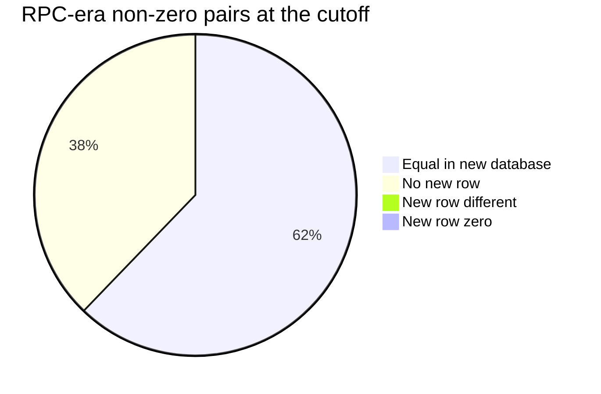
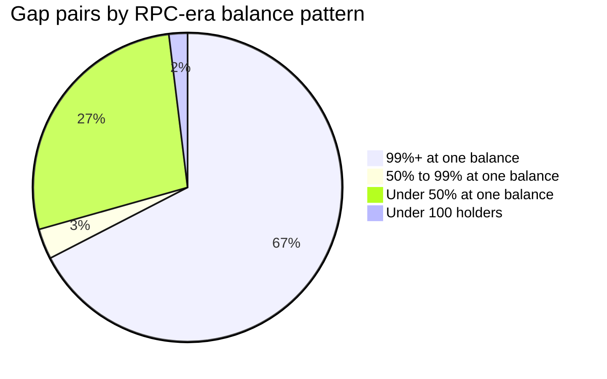
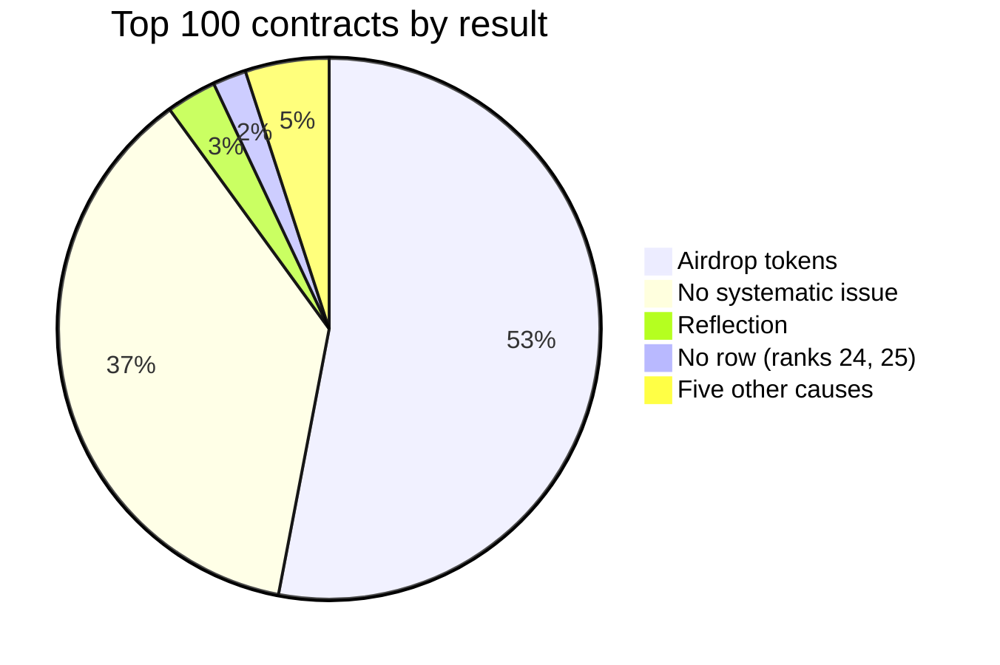
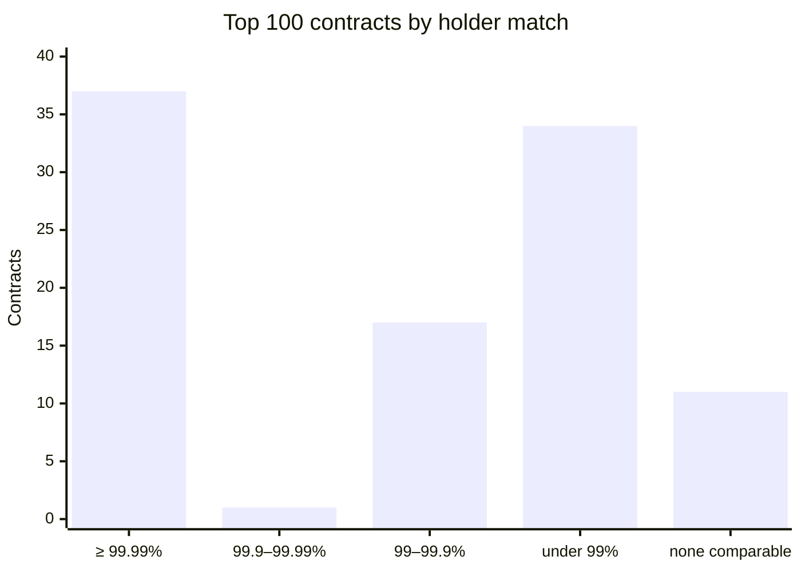
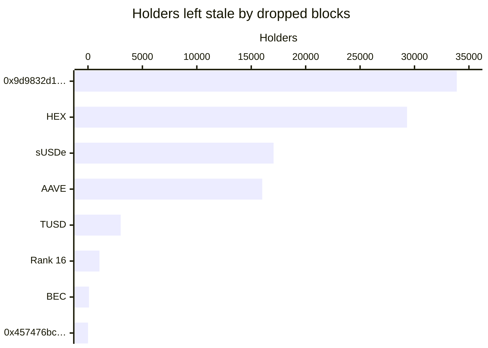
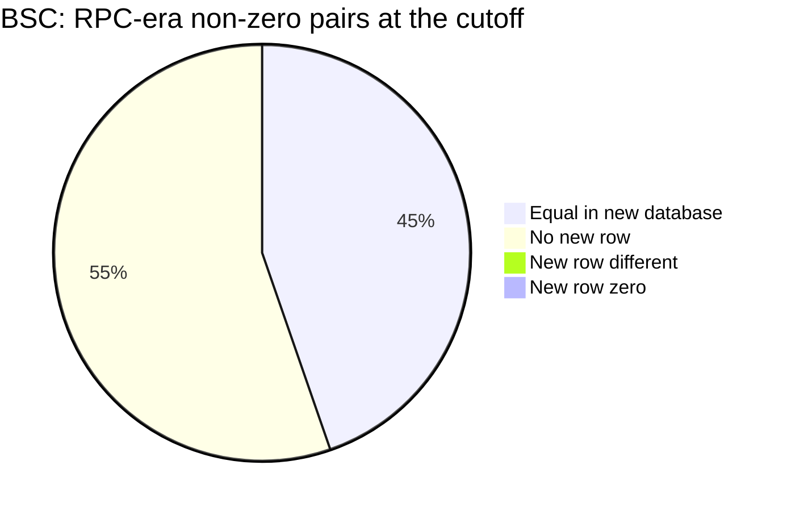
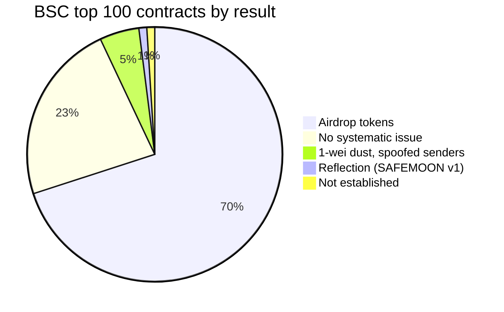

# ERC-20 balance quality

How the new ERC-20 databases compare with the RPC-era databases that the
Token API serves today: `mainnet:evm-balances-erc20@v0.7.4` against
`mainnet:evm-balances@v0.3.3` at block 26,214,999 (2026-10-17 21:35 UTC), and
`bsc:evm-balances-erc20@v0.7.4` against `bsc:evm-balances@v0.3.3` at block
128,354,999. USDT, USDC, WETH and WBNB have their own
[page](quality-top-tokens.md).

> [!NOTE]
> The sections up to [Open checks](#open-checks) cover Ethereum. BSC, added
> on 2026-10-20, is in its own section, [BSC](#bsc), with the same
> structure.

## Summary

What the new database emits is right, but it covers 62% of the RPC-era's
holder pairs, and some real tokens are not served or are stale.

| Measure | Ethereum | BSC |
| --- | ---: | ---: |
| New non-zero rows equal to the RPC-era row | 99.26% | 99.39% |
| The same, among rows that can be compared | 99.49% | 99.73% |
| RPC-era non-zero (contract, holder) pairs reproduced | 62.08% | 44.65% |
| Holders reproduced, top-100 contracts with no systematic issue | 99.9956% (37) | 99.9990% (23) |
| Holders reproduced, USDT, USDC and WETH or WBNB | > 99.99% | > 99.99% |

- **Ordinary tokens are accurate.** Among the top 100 contracts by holder
  count, the 37 with no systematic issue reproduce 99.9956% of the RPC-era's
  non-zero holders (52,743,865 of 52,746,202), and most of the rest are
  RPC-era errors. USDT, USDC and WETH reproduce more than 99.99% of their
  non-zero holders ([top tokens](quality-top-tokens.md)).
- **What the new database emits is right.** 99.26% of its non-zero rows
  equal the RPC-era row, and 99.49% of those that can be compared.
- **It covers 62% of all holder pairs.** It reproduces 62.08% of the
  RPC-era's non-zero (contract, holder) pairs, close to the package's
  measured recall on BSC. Two thirds of the pairs in the contracts it misses
  are in tokens where 99% of the holders share one balance, the signature
  of airdrop and address-poisoning tokens. Their balances exist only in
  `balanceOf` and in `Transfer` events without storage writes.
- **Some real tokens are not served.** Computed balances (shares,
  rebasing, scaled, reflection), balances kept in another contract, and the
  zero address are outside the package's design. They are listed
  [below](#tokens-the-new-database-does-not-serve).
- **Some real tokens are stale.** Changes made by `Mint` or `Burn` events
  without a `Transfer`, and contract-blocks the inference dropped, leave old
  values: MKR, HEX, TUSD, sUSDe, AAVE and others
  ([below](#where-the-new-database-is-wrong)).
- **The RPC-era database has its own errors.** It lost balance rows on
  2026-02-24 and 2026-03-11, stored pre-block balances in a few backfill
  blocks, and its backfilled history is sparse.

## How it was measured

The queries ran on 2026-10-19 and were read-only, with no RPC or Firehose
call. As for [native](quality-native.md), a second pass rechecked each
analysis: it recomputed the numbers, re-derived parts with other queries and
tried to refute the attributions. This page gives the corrected results.
[Methods](quality-methods.md) has the SQL.

The ERC-20 package infers balances from each block's persisted storage
writes, and drops a contract's rows for a block on any doubt. Its rows are
[measured, not qualified](../erc20/balances/README.md#measured), and its
[limits](../erc20/balances/README.md#limits) predict most of what follows.

## Coverage of all contracts

The new database reproduces 62.08% of the RPC-era's non-zero pairs, and
almost all the others have no new row. Two thirds of the pairs in the
contracts it misses are in tokens with the airdrop signature.

| Measure | RPC-era v0.3.3 | New v0.7.4 |
| --- | ---: | ---: |
| Contracts with any row | 1,670,038 | 1,428,012 |
| Contracts in both | 1,427,461 | 1,427,461 |
| Contracts only in this database (at or before the cutoff) | 241,101 | 551 |
| (contract, holder) rows | 765,289,050 | 443,936,986 |
| Non-zero rows (RPC-era: at or before the cutoff) | 325,375,129 | 203,481,210 |

The RPC-era's non-zero pairs by what the new database holds for them; the
two groups under 1% are too small to see, and the table below has them.

| RPC-era non-zero pairs at or before the cutoff | Pairs | Share |
| --- | ---: | ---: |
| Equal in the new database | 201,981,121 | 62.08% |
| No new row | 122,791,060 | 37.74% |
| New row zero | 84,510 | 0.03% |
| New row different and non-zero | 518,233 | 0.16% |

Seen from the new side, the 203,481,210 non-zero new rows are:

| Non-zero new rows | Rows |
| --- | ---: |
| Equal to the RPC-era row | 201,981,121 |
| Zero in the RPC-era | 525,965 |
| Different | 518,233 |
| With an RPC-era row after the cutoff | 445,215 |
| With no RPC-era row | 10,676 |

### Where the missing pairs are

The pairs that the new database misses sit in 499,228 "gap" contracts: no
new row at all (182,365 contracts) or fewer than half of the RPC-era's
non-zero holders (316,863). Two thirds of their pairs are in contracts with
at least 100 holders, at least 99% of them at one balance.

RPC-era non-zero pairs of the gap contracts, by how many holders share one
balance (the first three groups have at least 100 holders).

| Gap contracts by RPC-era pattern | Contracts | RPC-era non-zero pairs | Share |
| --- | ---: | ---: | ---: |
| ≥ 100 holders, ≥ 99% of them at one balance | 18,914 | 82,290,461 | 67.4% |
| ≥ 100 holders, 50% to 99% at one balance | 589 | 3,890,849 | 3.2% |
| ≥ 100 holders, fewer than 50% at one balance | 14,386 | 33,496,942 | 27.4% |
| Fewer than 100 holders | 465,339 | 2,370,452 | 1.9% |

One balance shared by 99% of the holders is the airdrop signature. Of the 50
largest gap contracts, 45 are airdrops or address poisoning by their event
pattern (batch transfers of one amount, or spoofed senders). The signature is
not proof on its own: 350 covered contracts also have it.

The 551 contracts only in the new database hold 9,705 rows; 7 of the largest
10 have no `balanceOf` selector in their code.

## Top 100 contracts by holders

The 53 airdrop tokens aside, the 37 contracts with no systematic issue
reproduce 99.9956% of their RPC-era non-zero holders. The other 10 each have
one systematic issue.

The 100 contracts with the most non-zero RPC-era holders at the cutoff (the
100th has 335,070), each compared in a full join.

| Measure | Value |
| --- | ---: |
| Holder match, all comparable holders | 177,850,020 / 177,930,584 (99.9547%) |
| RPC-era non-zero holders reproduced | 63,735,249 / 103,474,904 (61.59%) |
| The 37 contracts with no systematic issue | 52,743,865 / 52,746,202 (99.9956%) |

The top 100 by what explains their result; the five other causes are one
contract each, listed below.

| Result | Contracts | Ranks |
| --- | ---: | --- |
| Airdrop tokens | 53 | [listed below](#airdrop-tokens) |
| No systematic issue | 37 | [listed below](#no-systematic-issue) |
| Reflection | 3 | 37, 51, 85 |
| No row (cause unknown; spoofed senders) | 2 | 24, 25 |
| Rebasing shares (stETH) | 1 | 36 |
| Stake mints and burns missed (HEX) | 1 | 2 |
| Changes missed (TUSD) | 1 | 99 |
| 2^128 guard (BEC) | 1 | 88 |
| `balanceOf` adds a bonus | 1 | 16 |

Number of the top 100 contracts in each band of holder match (the share of
comparable holders whose balances agree).

| Band | Holder match | Value match (no 0x0) | Reproduced |
| --- | ---: | ---: | ---: |
| ≥ 99.99% | 37 | 38 | 37 |
| 99.9% to 99.99% | 1 | 6 | 1 |
| 99% to 99.9% | 17 | 6 | 2 |
| < 99% | 34 | 39 | 49 |
| No comparable holder | 11 | 11 | 11 |

"Value match" excludes the zero address. "Reproduced" counts the RPC-era
non-zero holders that the new database reproduces.

### Airdrop tokens

53 of the 100 are airdrop tokens: in each, 99.66% to 100% of the RPC-era
rows hold one identical balance, and the new database has 0% to 0.29% of
them. For two of them (ranks 6 and 7,
`0xb96f8b307544645ddb31ceef8affac2366dbef39` and
`0xc80b4457fccd49e7c3a2f5566dd1b827d85f6c98`), the RPC-era balances add up
to millions of times the token's single mint, so they are `balanceOf`
defaults that no storage holds. For three checked from 2017 and 2018, the
balances are covered by mint events, and the mechanism is not established.

Ranks of the 53 airdrop tokens

6, 7, 10 to 13, 17 to 19, 23, 26 to 28, 33, 39, 41, 45 to 48, 50, 53, 54,
56, 57, 59 to 64, 66 to 70, 72 to 76, 79 to 81, 84, 86, 87, 89, 90, 92, 94,
96 and 100.

### The other 47

Names are public token names, not from the databases. Unnamed contracts show
the start of their address; the full table below has every address. A dash
means no comparable holder.

#### With a systematic issue

| # | Token | Holder match | Reproduced | Cause |
| ---: | --- | ---: | ---: | --- |
| 2 | HEX | 99.6883% | 99.8618% | stake mints and burns missed |
| 16 | `0xc12d1c73…` | 98.2142% | 98.0999% | `balanceOf` adds a bonus |
| 24 | `0xa3ee21c3…` | – | 0% | no row, cause unknown |
| 25 | `0x82866b4a…` | – | 0% | spoofed senders |
| 36 | stETH | 32.8885% | 0.0200% | rebasing shares |
| 37 | `0xa3e78337…` | – | 0% | reflection |
| 51 | `0xc0114f14…` | – | 0% | reflection |
| 85 | `0x8b3192f5…` | – | 0% | reflection |
| 88 | BEC | 99.9864% | 99.9989% | 2^128 guard (2018 overflow) |
| 99 | TUSD | 99.4627% | 99.0554% | 2020 changes missed |

#### No systematic issue

These 37 reproduce 52,743,865 of their 52,746,202 RPC-era non-zero holders.
The notes mark isolated errors, described under
[Where the new database is wrong](#where-the-new-database-is-wrong) and
[Open checks](#open-checks).

| # | Token | Holder match | Reproduced | Note |
| ---: | --- | ---: | ---: | --- |
| 1 | USDT | 99.9982% | 99.9911% | |
| 3 | USDC | 99.9978% | 99.9912% | |
| 4 | WETH | 99.9960% | 99.9995% | |
| 5 | `0x6051c135…` | 100% | 100% | |
| 8 | LPT | 99.9999% | 99.9999% | burn without `Transfer` (2) |
| 9 | SHIB | 99.9996% | 99.9989% | |
| 14 | `0x43e6228b…` | 100% | 100% | |
| 15 | `0x9d24364b…` | 100% | 100% | |
| 20 | `0xf230b790…` | 99.9999% | 99.9998% | 99.6% of value at 0x0 |
| 21 | `0x519475b3…` | 100% | 100% | |
| 22 | LINK | 99.9995% | 99.9978% | |
| 29 | `0xab95e915…` | 100% | 99.9999% | |
| 30 | `0xb131f4a5…` | 99.9997% | 99.9995% | |
| 31 | `0x9b209d0d…` | 100% | 100% | |
| 32 | DAI | 99.9990% | 99.9957% | |
| 34 | `0xd3e8695d…` | 100% | 99.9999% | 6.9% of value at 0x0 |
| 35 | OMG | 100% | 99.9998% | |
| 38 | MATIC | 100% | 99.9998% | |
| 40 | `0x2dbd330b…` | 100% | 99.9998% | |
| 42 | PEPE | 99.9992% | 99.9980% | |
| 43 | `0xc89b4a8a…` | 99.9998% | 99.9998% | |
| 44 | `0xe52d53c8…` | 100% | 100% | |
| 49 | `0xcb696c86…` | 99.9996% | 99.9990% | |
| 52 | `0x03829f56…` | 100% | 100% | |
| 55 | `0xf3e014fe…` | 100% | 100% | |
| 58 | `0xac08809d…` | 100% | 100% | |
| 65 | DATA (old) | 99.9915% | 99.9957% | 41 changes with no event |
| 71 | BAT | 99.9999% | 99.9995% | |
| 77 | `0xbddab785…` | 100% | 100% | |
| 78 | `0xa5959e94…` | 100% | 100% | |
| 82 | UNI | 99.9995% | 99.9982% | |
| 83 | `0x4dc3643d…` | 100% | 99.9992% | |
| 91 | `0x174bfa66…` | 100% | 100% | |
| 93 | `0x77fe30b2…` | 99.9989% | 99.9997% | burn without `Transfer` (4) |
| 95 | CRO | 99.9997% | 99.9994% | |
| 97 | `0x457476bc…` | 99.9983% | 99.9882% | 6 changes missed |
| 98 | BNB | 99.9994% | 99.9997% | burn without `Transfer` (3) |

All 47 contracts with every column

| # | Contract | Name | Comparable | Holder match | RPC-era non-zero | Reproduced | Value match (no 0x0) | Note |
| ---: | --- | --- | ---: | ---: | ---: | ---: | ---: | --- |
| 1 | `0xdac17f958d2ee523a2206206994597c13d831ec7` | USDT | 78,257,247 | 99.9982% | 15,160,234 | 99.9911% | 99.9979% | |
| 2 | `0x2b591e99afe9f32eaa6214f7b7629768c40eeb39` | HEX | 9,405,476 | 99.6883% | 9,048,556 | 99.8618% | 82.7640% | stake mints and burns missed |
| 3 | `0xa0b86991c6218b36c1d19d4a2e9eb0ce3606eb48` | USDC | 36,890,033 | 99.9978% | 9,000,258 | 99.9912% | 99.9920% | |
| 4 | `0xc02aaa39b223fe8d0a0e5c4f27ead9083c756cc2` | WETH | 6,646,980 | 99.9960% | 3,315,311 | 99.9995% | 99.9998% | |
| 5 | `0x6051c1354ccc51b4d561e43b02735deae64768b8` | | 2,934,818 | 100% | 2,930,992 | 100% | 100% | |
| 8 | `0x58b6a8a3302369daec383334672404ee733ab239` | LPT | 2,765,559 | 99.9999% | 1,765,688 | 99.9999% | 100% | burn without `Transfer` (2) |
| 9 | `0x95ad61b0a150d79219dcf64e1e6cc01f0b64c4ce` | SHIB | 5,358,054 | 99.9996% | 1,696,339 | 99.9989% | 99.9999% | |
| 14 | `0x43e6228b5bf22eab754486082ca91fdd8585521a` | | 1,419,985 | 100% | 1,415,782 | 100% | 100% | |
| 15 | `0x9d24364b97270961b2948734afe8d58832efd43a` | | 1,273,116 | 100% | 1,269,370 | 100% | 100% | |
| 16 | `0xc12d1c73ee7dc3615ba4e37e4abfdbddfa38907e` | | 1,261,809 | 98.2142% | 1,251,903 | 98.0999% | 91.3744% | `balanceOf` adds a bonus |
| 20 | `0xf230b790e05390fc8295f4d3f60332c93bed42e2` | | 1,556,127 | 99.9999% | 985,532 | 99.9998% | 100% | 99.6% of value at 0x0 |
| 21 | `0x519475b31653e46d20cd09f9fdcf3b12bdacb4f5` | | 974,995 | 100% | 955,870 | 100% | 100% | |
| 22 | `0x514910771af9ca656af840dff83e8264ecf986ca` | LINK | 4,049,503 | 99.9995% | 913,125 | 99.9978% | 99.9982% | |
| 24 | `0xa3ee21c306a700e682abcdfe9baa6a08f3820419` | | 0 | | 851,881 | 0% | | no row, cause unknown |
| 25 | `0x82866b4a71ba9d930fe338c386b6a45a7133eb36` | | 0 | | 844,838 | 0% | | spoofed senders |
| 29 | `0xab95e915c123fded5bdfb6325e35ef5515f1ea69` | | 773,976 | 100% | 746,757 | 99.9999% | 100% | |
| 30 | `0xb131f4a55907b10d1f0a50d8ab8fa09ec342cd74` | | 1,271,005 | 99.9997% | 738,420 | 99.9995% | 99.9999% | |
| 31 | `0x9b209d0df02c25fa7570c28c2add15225c3536ac` | | 724,327 | 100% | 720,444 | 100% | 100% | |
| 32 | `0x6b175474e89094c44da98b954eedeac495271d0f` | DAI | 3,102,118 | 99.9990% | 702,220 | 99.9957% | 99.9995% | |
| 34 | `0xd3e8695d2bef061eab38b5ef526c0f714108119c` | | 677,332 | 100% | 673,730 | 99.9999% | 100% | 6.9% of value at 0x0 |
| 35 | `0xd26114cd6ee289accf82350c8d8487fedb8a0c07` | OMG | 1,436,250 | 100% | 655,123 | 99.9998% | 100% | |
| 36 | `0xae7ab96520de3a18e5e111b5eaab095312d7fe84` | stETH | 1,049 | 32.8885% | 629,530 | 0.0200% | 0.0017% | rebasing shares |
| 37 | `0xa3e7833775a9cc022db2c72eb900378f90ce89b4` | | 0 | | 615,743 | 0% | | reflection |
| 38 | `0x7d1afa7b718fb893db30a3abc0cfc608aacfebb0` | MATIC | 2,401,908 | 100% | 613,711 | 99.9998% | 99.9996% | |
| 40 | `0x2dbd330bc9b7f3a822a9173ab52172bdddcace2a` | | 606,532 | 100% | 604,156 | 99.9998% | 100% | |
| 42 | `0x6982508145454ce325ddbe47a25d4ec3d2311933` | PEPE | 1,577,628 | 99.9992% | 593,613 | 99.9980% | 99.9996% | |
| 43 | `0xc89b4a8a121dd3e726fe7515e703936cf83e3350` | | 596,342 | 99.9998% | 592,959 | 99.9998% | 100% | |
| 44 | `0xe52d53c8c9aa7255f8c2fa9f7093fea7192d2933` | | 593,516 | 100% | 588,845 | 100% | 100% | |
| 49 | `0xcb696c86917175dfb4f0037ddc4f2e877a9f081a` | | 523,959 | 99.9996% | 523,697 | 99.9990% | 100% | |
| 51 | `0xc0114f14638a333a4d5c3b04f09b96372348a842` | | 0 | | 513,434 | 0% | | reflection |
| 52 | `0x03829f5675f3b51d0f8c2a74417a757625acf22f` | | 499,159 | 100% | 496,120 | 100% | 100% | |
| 55 | `0xf3e014fe81267870624132ef3a646b8e83853a96` | | 478,885 | 100% | 478,881 | 100% | 100% | |
| 58 | `0xac08809df1048b82959d6251fbc9538920bed1fa` | | 1,193,174 | 100% | 461,379 | 100% | 100% | |
| 65 | `0x0cf0ee63788a0849fe5297f3407f701e122cc023` | DATA (old) | 492,306 | 99.9915% | 444,310 | 99.9957% | 100% | 41 changes with no event |
| 71 | `0x0d8775f648430679a709e98d2b0cb6250d2887ef` | BAT | 1,462,088 | 99.9999% | 420,186 | 99.9995% | 99.9995% | |
| 77 | `0xbddab785b306bcd9fb056da189615cc8ece1d823` | | 401,421 | 100% | 400,763 | 100% | 100% | |
| 78 | `0xa5959e9412d27041194c3c3bcbe855face2864f7` | | 395,787 | 100% | 393,137 | 100% | 100% | |
| 82 | `0x1f9840a85d5af5bf1d1762f925bdaddc4201f984` | UNI | 1,637,700 | 99.9995% | 380,762 | 99.9982% | 99.9997% | |
| 83 | `0x4dc3643dbc642b72c158e7f3d2ff232df61cb6ce` | | 405,147 | 100% | 377,129 | 99.9992% | 99.9986% | |
| 85 | `0x8b3192f5eebd8579568a2ed41e6feb402f93f73f` | | 0 | | 367,821 | 0% | | reflection |
| 88 | `0xc5d105e63711398af9bbff092d4b6769c82f793d` | BEC | 706,472 | 99.9864% | 364,840 | 99.9989% | 0% | 2^128 guard (2018 overflow) |
| 91 | `0x174bfa6600bf90c885c7c01c7031389ed1461ab9` | | 519,881 | 100% | 356,473 | 100% | 100% | |
| 93 | `0x77fe30b2cf39245267c0a5084b66a560f1cf9e1f` | | 354,226 | 99.9989% | 352,798 | 99.9997% | 99.9999% | burn without `Transfer` (4) |
| 95 | `0xa0b73e1ff0b80914ab6fe0444e65848c4c34450b` | CRO | 701,894 | 99.9997% | 345,681 | 99.9994% | 100% | |
| 97 | `0x457476bc97adef10aba63fcadaefe503553fa0d2` | | 346,718 | 99.9983% | 338,425 | 99.9882% | 99.9990% | 6 changes missed |
| 98 | `0xb8c77482e45f1f44de1745f52c74426c631bdd52` | BNB | 644,503 | 99.9994% | 337,982 | 99.9997% | 100% | burn without `Transfer` (3) |
| 99 | `0x0000000000085d4780b73119b644ae5ecd22b376` | TUSD | 559,614 | 99.4627% | 335,906 | 99.0554% | 99.9496% | 2020 changes missed |

"Value match" counts RPC-era value only, so a new balance that is too high
does not lower it (HEX, TUSD, BNB). BEC's value match of 0% (full table
above) is its 2018 overflow: the
RPC-era holds the exploit's 2^255 balances, in blocks the new package
drops.

## Tokens the new database does not serve

> [!IMPORTANT]
> These are outside the package's design. The Token API should not serve
> them from the new database, or should label them.

- **Computed balances.** `balanceOf` derives the balance from a stored word,
  so no stored word equals it:
  - Shares and rebasing: stETH (629,530 RPC-era holders; 1,062 new rows,
    mostly stale), eETH, AMPL, sOHM v1 and v2, YAM v3, OUSD, OETH, USDM.
  - Scaled by an index: Aave v2 and v3 aTokens, Compound v3 `cUSDCv3`.
  - Reflection: KISHU, HOGE, FEG and at least 10 others, including ranks
    37, 51 and 85 above.
  - The wrapped forms are covered: wstETH, weETH, Compound v2 cUSDC and
    PAXG.
- **Balances in another contract or in checkpoints.** MiniMe tokens (LDO,
  SNT, ANT v1), Synthetix proxies (SNX, sUSD, sETH) and legacy TUSD
  (`0x8dd5fbce2f6a956c3022ba3663759011dd51e73e`) have no rows.
- **`balanceOf` adds an amount that is not stored.**
  - `0x0e69d0a2bbb30abcb7e5cfea0e4fde19c00a8d47` returns the stored balance
    plus exactly 1,000,000,000 (194,881 holders).
  - Rank 16 adds a bonus that the stored word does not hold (20,115
    same-block differences, needs RPC).
- **The zero address.** The package never emits holder `0x0`. For tokens
  that credit transfers to `0x0`, the RPC-era row holds a real balance: 35 of
  the top 100 have one, worth 99.6% of rank 20's value and 6.9% of rank
  34's.
- **Airdrop and address-poisoning tokens.** Noise; see
  [above](#where-the-missing-pairs-are).

## Where the new database is wrong

Two mechanisms leave old values: changes without a `Transfer` event, and
contract-blocks the inference dropped. A few whole tokens are also missing.

> [!WARNING]
> Rows carry the stored word, so they heal at the holder's next write. A
> stale value persists only for holders that never moved again, but the
> history is wrong until then.

### Changes without a `Transfer` event

`Mint` and `Burn` events do not vote
([rule 2](../erc20/balances/README.md#rules)), so a balance changed by them
alone keeps its old value or gets no row:

- MKR: 4,407 holders keep a value from before a later `Burn`.
- REP v1 (`0x1985365e9f78359a9b6ad760e32412f4a445e862`): 41,678 holders
  have no row. Those checked have only migration `Mint` events.
- BNB: 3 holders keep 1,623,830 BNB that `burn` destroyed. LPT: 2 holders.
  `0x77fe30b2…`: 4 holders.

### Contract-blocks dropped by the inference

A dropped block leaves the holder's previous value until its next write
([no carried state](../erc20/balances/README.md#limits)). By the event log,
the new database is stale for:

Stale holders per token, from the table below.

| Token | Holders | New minus RPC-era |
| --- | ---: | ---: |
| HEX | 29,313 | +18,615,718,325.94 HEX |
| `0x9d9832d1…` | 33,885 | |
| sUSDe | 17,051 | |
| AAVE | 16,010 | |
| TUSD | 3,007 | +49,933,266.91 TUSD |
| Rank 16 (`0xc12d1c73…`) | 1,057 | |
| BEC | 96 | |
| `0x457476bc…` | 6 | |

- HEX: stake start and end mints and burns.
- `0x9d9832d1…` is `0x9d9832d1beb29cc949d75d61415fd00279f84dc2`; sUSDe is
  `0x9d39a5de30e57443bff2a8307a4256c8797a3497`.
- TUSD: 2,923 of the 3,007 in blocks 10.0M to 11.0M (2020). TUSD also has
  2,740 RPC-era holders with no new row.
- BEC: exploit blocks 5,483,643 to 5,484,287, dropped by the 2^128 guard.

For HEX, sUSDe and AAVE, the event-implied balance equals the RPC-era value
for 97% to 99% of these holders, and every one has an event after the new
row. Why the blocks were dropped is not established.

### Whole tokens missing

OpenDAO SOS (`0x3b484b82567a09e2588a13d54d032153f0c0aee0`, 181,167 holders)
and FUN (`0x419d0d8bdd9af5e606ae2232ed285aff190e711b`, 72,801) have no rows,
although their RPC-era balances equal the event-implied ones for more than
99.6% of holders. The cause is open. About ten other real-looking tokens are
missing or partial without an identified cause.

### WETH deposits of 2018 and 2019

See [top tokens](quality-top-tokens.md#weth).

## Where the RPC-era database is wrong

The RPC-era database lost balance rows, mostly on 2026-02-24 and
2026-03-11, stored pre-block balances on a few backfill blocks, and its
backfilled history is sparse. 41.3 million of its zero rows in the top
100 contracts have no new row.

### Lost balance rows

In blocks 24,503,379 to 24,635,725, mostly 24,527,337 to 24,527,826
(2026-02-24 14:24 to 16:00 UTC) and 24,635,700 to 24,635,725 (2026-03-11
around 17:25 UTC), the RPC-era wrote no row for holders whose balance
changed. Its blocks table has every block, so these are missing rows, not
missing blocks. It affects 2,270 holders with an older RPC-era row and 908
with none (261 of them non-zero), in 16 tokens. The net `Transfer` flow
between the two rows equals the difference for all 889 checked in USDC,
SHIB, LINK, DAI, PEPE and `0xc89b4a8a…`, and for 1,280 of 1,280 in USDT.

| Token | Holders | New minus RPC-era |
| --- | ---: | ---: |
| USDT | 1,362 | −872,799.58 USDT |
| USDC | 807 | −2,547,478.54 USDC |
| SHIB | 18 | −587,595,133.77 SHIB |
| PEPE | 12 | −1,161,569,057.31 PEPE |
| DAI | 32 | −13,534.03 DAI |
| LINK | 19 | −15,251.95 LINK |

### Pre-block values on a few backfill blocks

On specific blocks between 23,220,071 and 23,338,667 (2025-08-25 to
2025-09-11), such as 23,300,269, 23,307,096, 23,312,290 and 23,337,883, the
RPC-era stored the balance from before the block: 303 holders (USDT 36,
USDC 11, WETH 253, SHIB, LINK and UNI 1 each). The rest of that window is
right: 46,898 of 46,899 rows in one USDC shard.

### Sparse history

Before its live start, the RPC-era kept about one row per holder per write
batch: 0.1% to 1.2% of an active USDT holder's changes. Its hourly bars
there are hours stale. In the live part, it writes a row per changed block.

### Zero rows

41.3 million RPC-era rows of the top 100 contracts are zero with no new row.
Zero-value transfers are the plausible trigger; the transfers database drops
them, so this is unverified.

## Open checks

> [!NOTE]
> These need RPC (`balanceOf` at the block), a live step that needs the
> owner's OK.

- DATA (old): 41 balance changes with no event of any type, such as
  (`0x5f80fa8a11fcab25bc4837f0009737d5e9ca9f3e`, 14,203,998).
- `0xcb696c86…`: (`0x1b77c98ad351a778a12f926f4f8256db1526fdd7`, 12,331,312).
- Rank 16: (`0x860633571a25d7fce3bf0935864d4f9db5e9b0ba`, 9,135,638).
- Rank 24 (`0xa3ee21c3…`): (`0x1949b670c7a9b65f8e08249d044b5580adaad58e`, 15,643,134).
- An airdrop token's default, for example `0x00e2b6d170740c15bf9fb01d0b6e77c0d4510e32`
  for `0x000000000000000000000000000000000002d34f` at 24,560,318.
- `0xba7435a4b4c747e0101780073eeda872a69bdcd4`, whose missing holders have
  outflows but no recorded inflows.

## BSC

`bsc:evm-balances-erc20@v0.7.4` against `bsc:evm-balances@v0.3.3`, at block
128,354,999. Holders changed after the cutoff are compared at the cutoff
hour, 2026-10-18 11:00 UTC. The queries ran on 2026-10-20, read-only, and
each analysis had the same second pass as Ethereum's.

BSC looks like Ethereum with more spam. Real tokens are reproduced almost
exactly, and what the new database emits is right (99.39% of its non-zero
rows equal the RPC-era row, 99.73% of those that can be compared). It covers
fewer pairs, 44.65%: 87.5% of the pairs in the contracts it misses are in
tokens where 99% of the holders share one balance, the signature of airdrop
and address-poisoning tokens.

*The RPC-era's 2,483,360,875 non-zero (contract, holder) pairs at or before
the cutoff, by what the new database holds for them.*

### BSC coverage of all contracts

| Measure | RPC-era v0.3.3 | New v0.7.4 |
| --- | ---: | ---: |
| Contracts with any row | 12,417,682 | 11,725,063 |
| Contracts in both (RPC-era row at or before the cutoff) | 11,723,189 | 11,723,189 |
| Contracts only in this database (at or before the cutoff) | 662,808 | 1,874 |
| (contract, holder) rows | 3,731,188,346 | 1,667,606,356 |
| Non-zero rows (RPC-era: at or before the cutoff) | 2,483,379,872 | 1,115,715,522 |

| RPC-era non-zero pairs at or before the cutoff | Pairs | Share |
| --- | ---: | ---: |
| Equal in the new database | 1,108,900,445 | 44.65% |
| No new row | 1,372,436,181 | 55.27% |
| New row zero | 524,627 | 0.02% |
| New row different and non-zero | 1,499,622 | 0.06% |

The new database's 1,115,715,522 non-zero rows: 1,108,900,445 equal the
RPC-era row, 1,540,394 are zero in the RPC-era, 1,499,622 differ, 3,751,589
have an RPC-era row after the cutoff and 23,472 have no RPC-era row.

The missing pairs sit in 936,175 gap contracts (645,182 with no new row,
290,993 with fewer than half of the RPC-era's non-zero holders), which hold
1,369,974,042 RPC-era non-zero pairs; in one shard, 99.1% of the missing
pairs are in gap contracts. By the RPC-era's balance pattern:

| Gap contracts | Contracts | RPC-era non-zero pairs | Share |
| --- | ---: | ---: | ---: |
| At least 100 holders, at least 99% of them at one balance | 14,520 | 1,199,346,974 | 87.5% |
| At least 100 holders, 50% to 99% at one balance | 6,206 | 50,595,026 | 3.7% |
| At least 100 holders, fewer than 50% at one balance | 36,366 | 111,385,352 | 8.1% |
| Fewer than 100 holders | 879,083 | 8,646,690 | 0.6% |

- **The 50 largest gap contracts** are 34 constant-amount airdrops sent by
  the contract or minted from `0x0`, 10 airdrops from one or a few other
  senders (one of them is the USDT contract, so a spoofed sender), 4 with
  spoofed senders, one reflection token (SAFEMOON v1) and one whose
  mechanism is not established (`0x2e058a17…`). 8 of them are EIP-1967
  proxies whose implementation was not read.
- **The 50 largest gap contracts with diverse balances** are 31 reflection
  tokens (SAFEMOON v1, BabyDoge and most 2021 BSC reflection forks), 8 with
  spoofed senders, 2 single-sender distributions, 2 EIP-1967 proxies and 7
  with no marker.
- **The 1,874 contracts only in the new database** hold 14,614 rows. 28 of
  the 50 largest have no `balanceOf` selector in their code, so the RPC era
  could not read them. 827 have RPC-era rows only after the cutoff.
- **The zero address.** 2,764,150 RPC-era rows of `0x0` are non-zero; the
  package never emits it.

### BSC top 100 contracts by holders

The 100 contracts with the most non-zero RPC-era holders at the cutoff, plus
CAKE, BTCB, USD1 and FDUSD.

| Measure | Value |
| --- | ---: |
| Holder match, all comparable holders | 459,927,871 / 459,952,392 (99.9947%) |
| RPC-era non-zero holders reproduced | 251,861,706 / 566,791,060 (44.44%) |
| The 23 contracts with no systematic issue | 251,790,295 / 251,792,696 (99.9990%) |
| The other 77 (airdrop, dust, reflection, not established) | 71,411 / 314,998,364 (0.0227%) |

*The 70 airdrop tokens hold 286,237,697 RPC-era non-zero holders, of which
the new database reproduces 0.0140%; for 23 single-mint ones, the RPC-era
sum is 19 to 9.5 million times the token's only mint, so those balances are
`balanceOf` defaults, not holdings.*

| Contracts by | ≥ 99.99% | 99.9% to 99.99% | 99% to 99.9% | < 99% | No comparable holder |
| --- | ---: | ---: | ---: | ---: | ---: |
| Holder match | 25 | 2 | 21 | 38 | 14 |
| Value match | 28 | 5 | 8 | 45 | 14 |
| RPC-era non-zero holders reproduced | 23 | 0 | 0 | 63 | 14 |

The real tokens (names are public token names, not from the databases):

| Token | Contract | Comparable | RPC-era non-zero | Reproduced | Value match |
| --- | --- | ---: | ---: | ---: | ---: |
| USDT | `0x55d398326f99059ff775485246999027b3197955` | 249,192,169 | 79,446,179 | ≥ 99.9975% | 99.9820% |
| WBNB | `0xbb4cdb9cbd36b01bd1cbaebf2de08d9173bc095c` | 12,881,203 | 5,162,447 | ≥ 99.9990% | 99.9419% |
| USDC | `0x8ac76a51cc950d9822d68b83fe1ad97b32cd580d` | 16,023,808 | 4,860,817 | 99.9962% | 99.9823% |
| BUSD | `0xe9e7cea3dedca5984780bafc599bd69add087d56` | 18,044,135 | 3,779,056 | 99.9979% | 99.9921% |
| ETH (Binance-Peg) | `0x2170ed0880ac9a755fd29b2688956bd959f933f8` | 7,461,372 | 2,565,709 | 99.9959% | 99.9896% |
| CAKE | `0x0e09fabb73bd3ade0a17ecc321fd13a19e81ce82` | 6,039,162 | 1,897,642 | 99.9962% | 99.9965% |
| BTCB | `0x7130d2a12b9bcbfae4f2634d864a1ee1ce3ead9c` | 4,981,332 | 1,706,097 | 99.9976% | 99.9982% |
| USD1 | `0x8d0d000ee44948fc98c9b98a4fa4921476f08b0d` | 4,699,947 | 482,861 | 99.9998% | 100.0000% |
| FDUSD | `0xc5f0f7b66764f6ec8c8dff7ba683102295e16409` | 243,525 | 23,457 | 99.9744% | 99.9888% |

The other 18 contracts with no systematic issue

| # | Contract | Comparable | RPC-era non-zero | Reproduced |
| ---: | --- | ---: | ---: | ---: |
| 2 | `0xa1ed61902f13e162305f59e1b2475e269e647777` | 64,675,315 | 64,656,168 | 100% |
| 4 | `0xb0b623959e4339bc4cdeba9dd8b1f0224ea57777` | 19,910,167 | 19,903,247 | 100% |
| 6 | `0x807a9c56e3b5f796ded8bdd85c4375b9bb45d396` | 12,927,630 | 12,927,602 | 100.0000% |
| 8 | `0x79efca6bb5d84b0ef7a666e4c87e3794432e7777` | 7,999,220 | 7,995,754 | 100% |
| 15 | `0xc3e48a10122621d396799d28acbfb473db647777` | 6,713,501 | 6,709,667 | 100% |
| 16 | `0xd19d52f2b0dc5e237e29aa27cebd2ef789d07777` | 6,162,828 | 6,159,043 | 100% |
| 26 | `0x963556de0eb8138e97a85f0a86ee0acd159d210b` | 4,833,832 | 4,804,511 | 100% |
| 31 | `0x8bc9534a9f1b4c87a1f2986f7007ae7e4a6e749e` | 4,107,789 | 4,082,467 | 100% |
| 33 | `0xecf897960b239c15ef19e0a07b50fd1ae9e37777` | 3,955,346 | 3,949,928 | 100% |
| 45 | `0xdf9e1a85db4f985d5bb5644ad07d9d7ee5673b5e` | 3,290,394 | 3,268,145 | 100% |
| 47 | `0x18d0e455b3491e09210292d3953157a4bf104444` | 3,267,031 | 3,246,992 | 100% |
| 70 | `0x69b14e8d3cebfdd8196bfe530954a0c226e5008e` | 2,840,915 | 2,745,633 | 100.0000% |
| 72 | `0xba331eff139710dc3c4f397cd0b9da0691c34cf4` | 2,765,990 | 2,738,531 | 100% |
| 76 | `0xccba7a0fbae70cb435f31ff4ac263af2fcd37777` | 2,705,148 | 2,704,203 | 100% |
| 82 | `0xd666ae17605ff6ff87c526f9d0da66abb0197777` | 2,609,694 | 2,607,207 | 100% |
| 91 | `0x0ee5fa4c8fa81bb11aaa922a2759a5f1e33a7777` | 2,511,731 | 2,508,199 | 100% |
| 92 | `0xc5e35ac8fed1b0128ea8f69d5481e2153e15a07d` | 2,503,206 | 2,503,203 | 100.0000% |
| 95 | `0x794bad5ea0b8d41be5cfd3f83919a83d3c788888` | 2,475,467 | 2,475,329 | 100.0000% |

- **No real token has a stale new row**: new older is 0 in all 27 of them.
  All 905 differences this sweep checked in them (335 new newer, 569
  non-zero only new, 1 same block) are RPC-era errors, settled by
  deduplicated `Transfer` flow: 904 holders in blocks the RPC era never
  wrote and one pre-block read. Examples, new minus RPC-era: BUSD
  −11,983.77 BUSD, CAKE −8,566.88 CAKE, FDUSD −5,008.88 FDUSD.
- **Holders changed after the cutoff** carry 0.85% to 97.46% of a real
  token's value (CAKE's 95.60% is the burn address `0x…dead`). All 66,213
  that were non-zero at the cutoff hour are equal in both databases.
- **The 5 dust tokens** (ranks 13, 20, 41, 44 and 66) hold 22,406,376
  RPC-era holders at 1 wei, from spoofed senders; their 18,481 same-block
  differences are all new 0 against RPC-era 1 wei. For rank 44
  (`0x2e058a17…`) the mechanism is not established.
- **Not served:** the reflection token SAFEMOON v1
  (`0x8076c74c5e3f5852037f31ff0093eeb8c8add8d3`, 2,885,775 holders), and
  rank 38 (`0xe68f87e4d841eab808b0420b15c1c618e5fca568`, 3,468,516 holders),
  whose RPC-era balances are neither stored nor event-backed (needs RPC).
- **The zero address** has a non-zero RPC-era row in 41 of these contracts,
  worth at most 4.02% of a contract's value.

### BSC: where the new database is wrong

> [!WARNING]
> As on Ethereum, the new database is stale where the inference dropped a
> contract-block, and it does not serve computed balances.

- **Stale rows after a dropped contract-block.** 87.7% of the 3,564,643
  present-but-different pairs have the new row older. Events confirm the
  new database stale for at least 14 of 23 checked pairs: the holder's later
  `Transfer` at the RPC-era row's block was not applied. Examples:
  `0x12e34cdf6a031a10fe241864c32fb03a4fdad739` (50,640 pairs),
  `0x385c279445581a186a4182a5503094ebb652ec71` (56,480),
  `0xee9801669c6138e84bd50deb500827b776777d28` (43,908) and
  `0x23766cb8a96ff2f46f664bc7d088a6306de73618` (91,992, a reflection-style
  token).
- **Computed balances.** Most same-block differences (428,881) are
  `balanceOf` defaults of spam tokens (about half return 1 for an empty
  word, such as `0x683e9dcf…`), reward, ratio, lock and rebasing tokens (for
  example `0x3790715d…`, `0x9879406c…`, `0x3273a291…`, `0x4238e5cc…`). Up to
  2.8% sit in the RPC-era's stale-read windows. Spam balances that
  underflow to 2^128 or more are kept at their earlier value by the 2^128
  guard (51.9% of one shard's RPC-era-non-zero, new-zero pairs).
- **Deposit-only WBNB credits of 2020**: 2 holders, 5.127 WBNB
  ([top tokens](quality-top-tokens.md#bsc-wbnb)).

### BSC: where the RPC-era database is wrong

- **Blocks it never wrote.** In the 2,063 blocks the RPC era never wrote
  (the 1,629 of 2024-01-18 and 434 live-sink blocks), 22,067 pairs have their
  latest new row: 6,979 RPC-era rows are older and different, 13,474 pairs
  have no RPC-era row, and 1,594 are equal. In the block range around
  122,049,723 to 122,049,880, where it kept the blocks but dropped some
  balance rows, 1,965 of 1,975 latest rows are equal.
- **Stale reads** at 84,599,556 to 84,599,584 (2026-03-04), as for native.
- **Sparse history.** Its backfilled hourly closes miss most holders' last
  changes before the hour; see the [USDT, USDC and WBNB history](quality-top-tokens.md#bsc-usdt-usdc-and-wbnb).
- **Zero rows.** 228,033,036 RPC-era rows of the top 100 contracts are zero
  with no new row (USDT 129,337,432, WBNB 68,437,219, USDC 12,449,250, BUSD
  11,603,088).

### BSC open checks

> [!NOTE]
> These need RPC or a Firehose read, live steps that need the owner's OK.

- Why the 2020 WBNB deposits fail the backed-deposit check (their Extended
  blocks, 1,180,462 and 2,415,928).
- Rank 38 `0xe68f87e4…` and rank 44 `0x2e058a17…`: what their `balanceOf`
  returns.
- The implementation code of the EIP-1967 proxies among the gap contracts
  (8 of the top 50, 63,887,171 holders).
- 258 of the 2,804 new-older rows in the spam and dust tokens, not checked
  against events.
