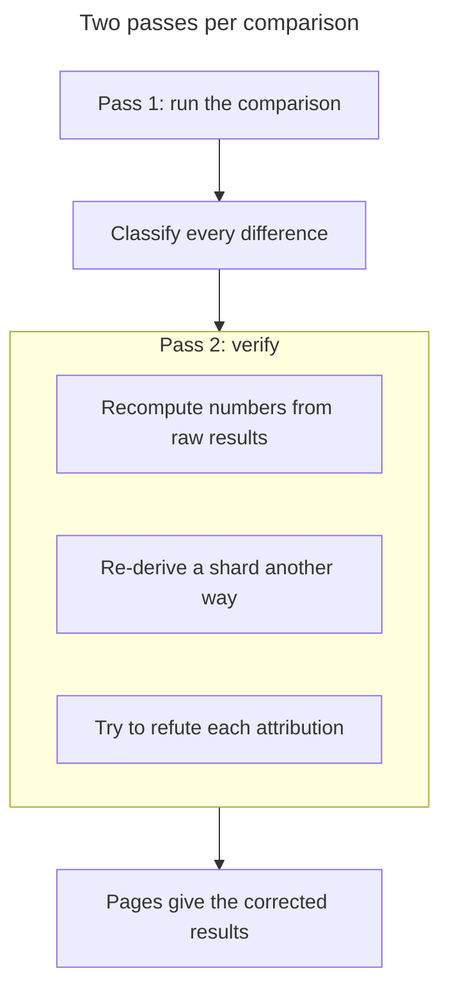
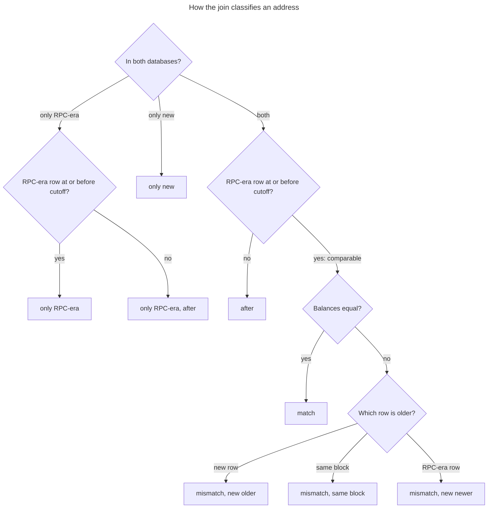

# Balance quality: methods

How the [native](quality-native.md), [ERC-20](quality-erc20.md) and
[top-token](quality-top-tokens.md) pages compare the new databases with the
RPC-era ones, with the SQL to rerun each comparison. The databases are listed
in [Deployment status](deployment-status.md).

| Check | Reads | Compares |
| --- | --- | --- |
| [Holder comparison](#holder-comparison-at-the-cutoff) | current balance tables | every address's latest balance, at the cutoff |
| [Top holders](#top-holders-at-the-cutoff-hour) | hourly balance bars | the top holders of both, at the cutoff hour |
| [Supply checks](#supply-checks) | contract balances and supply events | totals that depend on neither database |

## What is compared

Each comparison sets a new database against the RPC-era one, up to the
**cutoff**: the last block before the new database's end block.

| | New | RPC-era |
| --- | --- | --- |
| Databases | `<chain>:evm-balances-native@<version>` and `<chain>:evm-balances-erc20@<version>` | `<chain>:evm-balances@v0.3.3`, which the Token API serves today |
| Written from | Firehose Extended blocks, by this repository's packages, without RPC | RPC reads (`eth_getBalance`, `balanceOf`), made when the database sees an event that may change a balance |
| Range | backfilled up to a fixed end block | backfilled up to its live start block and live since then, so it runs past the cutoff |

> [!NOTE]
> Neither side is ground truth.
>
> - The RPC-era database misses a change when it sees no event for it, and it
>   can lag or skip blocks in its live part.
> - The new native database follows every persisted balance change, while the
>   new ERC-20 database infers balances and drops a contract's rows for a block
>   when in doubt ([measured, not qualified](../erc20/balances/README.md#measured)).
>
> So the pages classify each difference and say which side the evidence shows
> to be wrong. Where only an RPC call at the block could settle it, they say
> "needs RPC".

These comparisons made no RPC or Firehose call: running one is a live step
that needs the owner's OK ([AGENTS.md](../AGENTS.md#evidence)).

The RPC-era side is not fully independent either. Per its source at the
`evm-balances-v0.3.3` tag, its native module starts from the Extended
block's balance changes and replaces them with `eth_getBalance` only for the
addresses a transaction touches. So for an address changed without being
touched, such as an OP Stack fee vault, both databases read the same
Firehose data.

### Two passes per comparison

The pages give the corrected results of a second pass that tried to break the
first.



*The two passes behind every comparison on the quality pages.*

1. **Analysis.** The first pass ran the comparison and classified every
   difference.
2. **Verification.** The second pass recomputed the numbers from the raw
   results, re-derived at least one shard with another formulation
   (`argMax(balance, block_num) ... GROUP BY address` instead of `FINAL`,
   `NOT IN` or `LEFT ANTI JOIN` instead of the full join), and tried to
   refute each attribution.

## Holder comparison at the cutoff

A full outer join on the address gives the counts below.

`native_balances` and `erc20_balances` hold one row per address (per contract
and address for ERC-20). The row carries the latest balance and the block of
its last change. Both are `ReplacingMergeTree(block_num)` tables, so they are
read with `FINAL`.



*How the join classifies each address. Value match is a share of the balance
sum, not a class. The SQL below also requires a comparable RPC-era row to be
at or after `<min-block>`.*

| Count | SQL column | Meaning |
| --- | --- | --- |
| comparable | `comparable` | address in both databases, and the RPC-era row is at or before the cutoff, so both rows give the balance at the cutoff |
| match / mismatch | `match`; mismatch is the sum of the three `mismatch_*` columns | comparable rows with equal / different balances |
| mismatch, new older | `mismatch_new_older` | the new row is older than the RPC-era row: the new database missed a later change, or the RPC-era database recorded one that did not happen |
| mismatch, same block | `mismatch_same_block` | both rows are at the same block, but the balances differ |
| mismatch, new newer | `mismatch_new_newer` | the new row is newer: the RPC-era database missed a change (for example a fee, a reward or a gap in its live sink), or the new database recorded one that did not happen |
| after | `after` | address in both, but the RPC-era row is after the cutoff, so this join cannot compare it (the top-holder comparison can) |
| only RPC-era | `only_rpc` | address only in the RPC-era database, with its row at or before the cutoff |
| only RPC-era, after | `only_rpc_after` | address only in the RPC-era database, with its row after the cutoff: compare its hourly bars before the cutoff hour to see whether it held a balance at the cutoff |
| only new | `only_new` | address only in the new database |
| value match | `value_matched` / `value_total` | the share of the comparable RPC-era balance sum held by matching rows |

The `only_rpc_zero` and `only_new_zero` columns count the rows of
`only_rpc` and `only_new` whose balance is 0.

Native, sharded by address hash (repeat for `k` in `0..N-1` and add the
counts). Set `<min-block>` to the new database's first block on chains that
start after genesis (Optimism: 105,236,000), and 0 elsewhere.

<details>
<summary>SQL: native holder comparison, one shard</summary>

```sql
SELECT
  countIf(c) AS comparable,
  countIf(c AND nb = ob) AS match,
  countIf(c AND nb != ob AND nblk < oblk) AS mismatch_new_older,
  countIf(c AND nb != ob AND nblk = oblk) AS mismatch_same_block,
  countIf(c AND nb != ob AND nblk > oblk) AS mismatch_new_newer,
  countIf(isNotNull(nb) AND isNotNull(ob) AND oblk > <cutoff>) AS after,
  countIf(isNull(nb) AND oblk <= <cutoff>) AS only_rpc,
  countIf(isNull(nb) AND oblk <= <cutoff> AND ob = 0) AS only_rpc_zero,
  countIf(isNull(nb) AND oblk > <cutoff>) AS only_rpc_after,
  countIf(isNull(ob)) AS only_new,
  countIf(isNull(ob) AND nb = 0) AS only_new_zero,
  sumIf(toFloat64(ob), c AND nb = ob) AS value_matched,
  sumIf(toFloat64(ob), c) AS value_total
FROM
(
  SELECT n.*, o.*,
    isNotNull(nb) AND isNotNull(ob) AND oblk <= <cutoff> AND oblk >= <min-block> AS c
  FROM (SELECT address, balance AS nb, block_num AS nblk
        FROM `<new>`.native_balances FINAL
        WHERE cityHash64(address) % <N> = <k>) AS n
  FULL OUTER JOIN
       (SELECT address, balance AS ob, block_num AS oblk
        FROM `<chain>:evm-balances@v0.3.3`.native_balances FINAL
        WHERE cityHash64(address) % <N> = <k>) AS o
  ON n.address = o.address
)
SETTINGS join_use_nulls = 1, max_execution_time = 1800, max_threads = 8
FORMAT JSONEachRow
```

</details>

ERC-20 is the same query on `erc20_balances` with `WHERE contract = '<contract>'`
on both sides. That is cheap, because the table is ordered by
`(contract, address)`. USDT and USDC have tens of millions of rows, so shard
them as well.

## Top holders at the cutoff hour

Rows changed after the cutoff cannot be compared by the join. So the top-n
check reads both databases' hourly history instead: the
`historical_*_balances_state` bars with `interval_min = 60`.

1. **Holders.** The holder set is the union of both databases' current top n.
2. **Balance.** Each holder's balance is `argMaxMerge(close)` over the bars
   before the start of the hour that contains the cutoff block.
3. **Rank.** A holder ranks by its RPC-era balance (`rank_old`), and also by
   its new balance (`rank_new`), which catches phantom holders that exist only
   in the new database.

<details>
<summary>SQL: native top holders at the cutoff hour</summary>

```sql
WITH holders AS (
  SELECT address FROM (SELECT address FROM `<new>`.native_balances FINAL ORDER BY balance DESC LIMIT 1000)
  UNION DISTINCT
  SELECT address FROM (SELECT address FROM `<old>`.native_balances FINAL ORDER BY balance DESC LIMIT 1000)
),
hour AS (SELECT toStartOfHour(max(timestamp)) FROM `<new>`.blocks WHERE block_num <= <cutoff>)
SELECT address, ifNull(nb, 0) AS nb, ifNull(ob, 0) AS ob,
  row_number() OVER (ORDER BY ifNull(ob, 0) DESC) AS rank_old,
  row_number() OVER (ORDER BY ifNull(nb, 0) DESC) AS rank_new
FROM (SELECT address, argMaxMerge(close) AS nb FROM `<new>`.historical_native_balances_state
      WHERE interval_min = 60 AND timestamp < (SELECT * FROM hour) AND address IN holders GROUP BY address) AS n
FULL OUTER JOIN
     (SELECT address, argMaxMerge(close) AS ob FROM `<old>`.historical_native_balances_state
      WHERE interval_min = 60 AND timestamp < (SELECT * FROM hour) AND address IN holders GROUP BY address) AS o
USING address
SETTINGS join_use_nulls = 1, max_execution_time = 900
```

</details>

For ERC-20, use `erc20_balances` and `historical_erc20_balances_state`, and
add `AND contract = '<contract>'` everywhere. The same bars, read at earlier
hours, give the historical checks on the [top-token page](quality-top-tokens.md).
The history views keep the intervals the Token API serves:

| Interval | `interval_min` |
| --- | ---: |
| 1h | 60 |
| 4h | 240 |
| 1d | 1440 |
| 1w | 10080 |

## Supply checks

Some tokens give a total that does not depend on either database:

- **WETH9-style wrapped native tokens** (WETH, WBNB, WPOL, WHYPE):
  `totalSupply()` is the contract's own native balance. So the sum of all
  holder token balances is at most the contract's native balance in the
  native database. The gap is native currency sent to the contract without a
  `Deposit`, through a self-destruct or a block reward, and is usually tiny.
- **USDT and USDC**: the total supply follows from the issue, redeem, mint
  and burn events (and USDT's `DestroyedBlackFunds`) in
  `mainnet:evm-transfers@v0.3.3`, wherever those tables cover the full
  history.

## Evidence databases

Check each table's actual row range, not only its `backfill_processed_ranges`,
before reading anything into an absence. The pages explain differences with
`<chain>:evm-transfers@v0.3.3` (transfers, native transfers, blocks) and
`<chain>:evm-contracts@v0.3.0` (deployed code).

> [!CAUTION]
> Some evidence tables hold duplicate rows. Deduplicate on (`tx_hash`,
> `log_index`) before summing.

**Duplicate rows.** `mainnet:evm-transfers@v0.3.3`'s `transfers` table is a
plain MergeTree with repeated rows.

| Repeats in mainnet `transfers` | Blocks |
| --- | --- |
| 42,140 extra USDT rows | 11,780,000 to 11,789,999 |
| 9,879 duplicated USDC (`tx_hash`, `log_index`) keys | 11,262,961 to 24,571,109 |
| repeats in 1,243 blocks | 14,497,047 to 14,509,804 |
| every `burn` stored as three rows | |

Duplicates also appear on Optimism, Unichain and HyperEVM.

**Missing kinds.**

- It holds no zero-amount transfer.
- `native_transfers` holds value transfers (and Ethereum's block rewards),
  not fees.
- The `withdrawals` and `selfdestructs` tables are empty.
- HyperEVM has no internal-call transfers before block 44,830,465. Its
  `transactions` and `calls` tables, and per-event tables such as `usdt_*`,
  `usdc_mint` and `weth_deposit`, hold only recent blocks.
- Use `transfers.transfer_type` for mints, burns, deposits and withdrawals.

**Drift and gaps.**

- On Ethereum, the cumulative WETH deposits minus withdrawals in `transfers`
  depart from the WETH contract's native balance by up to 110,537 ETH, so
  they cannot serve as WETH's supply.
- On Polygon, a WPOL history rebuilt from the raw rows exceeds the supply by
  11.38M WPOL, all of it duplicates: deduplicated, the four largest outliers
  equal the RPC-era to the wei.
- `polygon:evm-transfers@v0.3.3` also lacks 2,048,962 blocks with native
  changes, 2,026,476 of them between 2020-05 and 2021-04.

**Missing RPC-era rows are not always missing blocks.** An anti-join of the
`blocks` tables finds only blocks the RPC-era never wrote. It also wrote
blocks without some of their balance rows (Ethereum on 2026-02-24, BSC
around 122,049,723 to 122,049,880), which only a row comparison shows.

**History views.** `historical_erc20_balances_state` is ordered by
(`interval_min`, `address`, `contract`, `timestamp`). Selecting one token's
top holders at a past hour scans every contract's bars, so narrow the holder
set first, for example to holders with a weekly high above a threshold.

## Running the queries

> [!WARNING]
> "Value match" covers comparable addresses only. The addresses changed
> after the cutoff often hold much of the value (84% on Unichain, 32% of
> USDC), so compare them from the hourly bars too.

- The new databases do not change once backfilled, but the RPC-era databases
  do. So rerunning a comparison later moves holders from "comparable" to
  "after", and the counts shift a little.
- The full joins scan both tables completely. On a shared cluster, shard them
  by `cityHash64(address) % N`, as above (table below). Run few at a time,
  with `max_threads` and `max_execution_time` set. The default limit of 60
  seconds is too short for the larger joins.
- A new database's `blocks` table has a row only for blocks with a balance
  change, so its absent blocks are not gaps. Coverage is in
  `backfill_processed_ranges`.
- A cutoff block with no balance change has no row in the new `blocks`
  table. Take the cutoff hour from `block_num <= <cutoff>`, as above, not
  `block_num = <cutoff>`, which gives 1970-01-01.

| Tables | Shards |
| --- | ---: |
| the large native tables (Ethereum, BSC, Base, Polygon) | 16 to 48 |
| USDT and USDC | 4 to 8 |
