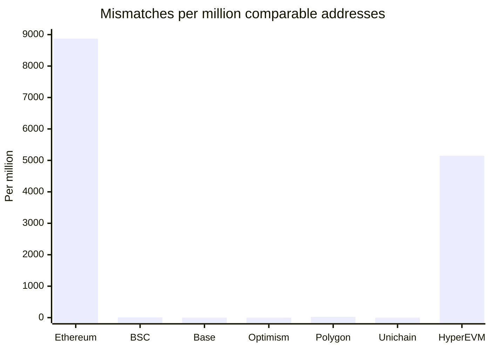
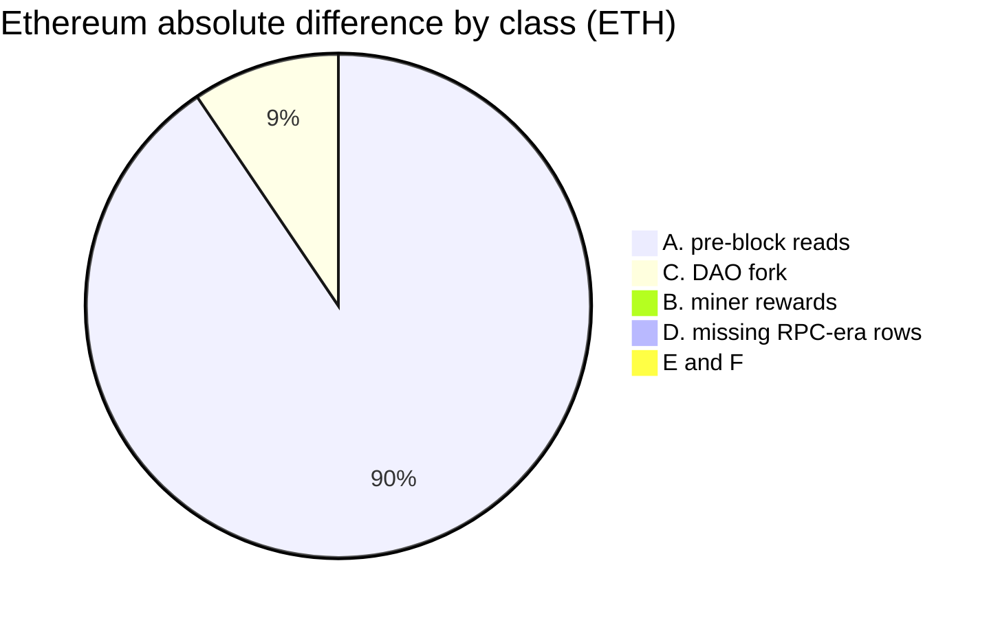

# Native balance quality

Where the new native databases and the RPC-era databases disagree, the new
database is right for nearly every difference. It has four real gaps,
described [below](#gaps-in-the-new-databases).

This page compares the seven fully backfilled native databases with the
RPC-era databases that the Token API serves today,
`<chain>:evm-balances@v0.3.3`. Each chain is compared at its cutoff, the last
block of its backfill ([Deployment status](deployment-status.md)). The
queries ran on 2026-10-19 and were read-only. No RPC, Substreams or Firehose
call was made. [Methods](quality-methods.md) defines the counts and gives the
SQL.

How the numbers were checked

Each chain had two passes. An analysis pass ran the full comparison and
classified every difference. A second pass then recomputed the numbers from
the raw shard results and re-derived at least one shard with a different
query (`argMax ... GROUP BY` instead of `FINAL`, anti-joins instead of the
full join). It also tried to refute each attribution. This page gives the
corrected results.

## Summary

| Chain | Match | Value match | Top 1,000 equal | Wrong in the new database |
| --- | ---: | ---: | ---: | --- |
| Ethereum | 99.1129% | 98.5950% | 988 | 🔍 72 contracts, 0.00153 ETH (likely) |
| BSC | 99.9992% | 99.9973% | 1,000 | ✅ none found |
| Base | 99.999999% | 99.99999998% | 1,000 | ✅ none found |
| Optimism | 99.999996% | 100% (2 wei short) | 999 | ⚠️ legacy balances (below) |
| Polygon | 99.9975% | 99.9967% | 1,000 | 🛠️ 61 contracts, at least 1,831.73 POL |
| Unichain | 100% | 100% | 1,000 | 🔍 3 early history gaps |
| HyperEVM | 99.4852% | 99.2676% | 964 | ✅ none found |

✅ none found, ⚠️ issue, 🛠️ fix in progress, 🔍 open check.

| Chain | Cutoff | Comparable addresses | Non-zero match | Mismatches |
| --- | ---: | ---: | ---: | ---: |
| Ethereum | 26,197,999 | 344,635,421 | 98.5441% | 3,057,156 |
| BSC | 127,809,999 | 524,348,682 | 99.9988% | 4,115 |
| Base | 52,719,999 | 311,058,420 | 99.999999% | 3 |
| Optimism | 158,319,999 | 25,911,688 | 99.999996% | 1 |
| Polygon | 95,689,999 | 196,742,101 | 99.9966% | 4,955 |
| Unichain | 61,489,999 | 8,381,431 | 100% | 0 |
| HyperEVM | 48,779,999 | 1,201,262 | 99.3627% | 6,184 |

"Comparable" addresses are in both databases with the RPC-era row at or
before the cutoff. "Value match" is the share of their RPC-era balance held by
matching rows. It leaves out the addresses changed in the RPC-era after the
cutoff, which often hold most of the value: 84% on Unichain. Those addresses
were compared from the hourly bars instead (per chain, below). The RPC-era
databases are live, so their counts drift between queries by a few addresses
moving from "comparable" to "after".

Mismatches divided by comparable addresses, times a million, from the table
above: Ethereum 8,871, HyperEVM 5,148, Polygon 25.2, BSC 7.8, Optimism 0.04,
Base 0.01, Unichain 0. Only Ethereum and HyperEVM are tall enough to see.
Where the evidence settles a mismatch, the RPC-era is wrong for nearly all of
them (below).

### What the differences are

- **The new databases are right for nearly every difference.** Where the
  evidence settles a mismatch, the RPC-era database is wrong for all but 133
  addresses (72 on Ethereum, 61 on Polygon): rows it never wrote (skipped
  blocks, missed internal transfers), or balances it read from before the
  block.
- **The new databases have four real gaps.** Polygon misses some
  self-destruct debits. Optimism has no row for balances that have not
  changed since Bedrock. On Ethereum, 72 contracts likely keep a small
  credit. On Unichain, three early credits are missing from the history.
  They are described [below](#gaps-in-the-new-databases).
- **No new database invents a balance.** Wherever the new database has an
  address the RPC-era lacks ("only new"), the RPC-era missed the change that
  funded it.
- **Zero rows differ by design.** The RPC-era writes a zero-balance row for
  every address a transaction touches; the new package writes a row only
  when a balance changes. The RPC-era-only addresses (127 million on
  Ethereum, 385 to 489 million on BSC, Base, Optimism and Polygon) are all
  zero, except 7 on Ethereum (0.00008 ETH), 1 on Polygon (1.1 POL) and the
  legacy balances on Optimism.
- **The RPC-era history is sparse.** Its backfilled hourly bars keep about
  one row per address per write batch, so they often show a balance from
  hours earlier. Where both databases have a row at the same block, the
  values agree. The new history records every change.

## Gaps in the new databases

Four gaps are real. Polygon's has a fix in progress. Optimism's needs a
seed before a cutover. The Ethereum and Unichain gaps are open checks.

| Chain | Gap | Size | Status |
| --- | --- | --- | --- |
| Polygon | [Missed self-destruct debits](#polygon-missed-self-destruct-debits) | 61 contracts, and 9 found by v0.7.11's backfill; at least 1,831.73 POL over-counted | 🛠️ native v0.7.12 |
| Optimism | [Balances not changed since Bedrock](#optimism-balances-not-changed-since-bedrock) | 411,978 addresses; 501.44 ETH by the RPC-era's reading, an estimate | ⚠️ needs the Bedrock state seeded |
| Ethereum | [Credits of contracts created in the transaction](#ethereum-credits-of-contracts-created-in-the-transaction) | 72 contracts, 0.00153 ETH | 🔍 needs `eth_getBalance` |
| Unichain | [Three early credits missing from the history](#unichain-three-early-credits-missing-from-the-history) | 3 addresses | 🔍 needs the Firehose blocks |

### Polygon: missed self-destruct debits

> [!WARNING]
> The new Polygon database over-counts at least 1,831.73 POL. 61 contracts
> explain 1,694.17 POL of it: a self-destruct credited their balance to the
> beneficiary, but the new database never debited the contract, so it counts
> the POL twice. Native v0.7.11 fixes 58 of them, but its Polygon backfill
> stopped on 9 more contracts in a near-shape, which native v0.7.12 fixes
> ([below](#polygon-missed-self-destruct-debits)). Polygon resyncs after it.

**What the databases show.** 61 contracts keep a balance in the new database
(1,694.17 POL in all) that the RPC-era reads as 0 at a later block, between
blocks 55.41M and 71.46M (April 2024 to May 2025). Each balance leaves
without a value transfer. For the two largest (1,443.16 POL, 85% of the
class), the contract's deployer is credited with exactly that amount in the
same block, and both databases agree on the deployer's balance. So the new
database credited the beneficiary but never debited the contract, and counts
the POL twice.

**A supply check bounds the total.** Polygon PoS mints no
native POL after genesis, and the new database's block-0 records sum to
exactly 10,000,000,000 POL. Its balances at the cutoff sum to
10,000,001,831.73 POL. So the new database over-counts at least 1,831.73 POL.
The 61 contracts explain 1,694.17 POL of it. The other 137.56 POL are not
located: a missed debit on an account the RPC-era never re-read counts as a
match, because both databases hold the same wrong value.

**The cause** was found on 2026-10-20, in the 61 blocks fetched with the
owner's OK. On Polygon after its Napoli fork (EIP-6780), the producer does
not mark these self-destructs.

- In 56 of the 61 blocks, the self-destructing call has its `suicide` flag
  unset: it is the transaction's root call in 50 and a call one level down
  in 6. It holds exactly one `SUICIDE_REFUND`, the beneficiary's credit of
  the contract's whole balance, and the transaction has no record of the
  contract at all.
- v0.7.8 restores the missing debit only for a call marked as a
  self-destruct
  ([native README](../native/balances/README.md#continuity-exceptions)), so
  it skips these.
- In block 55,741,124, for example (transaction
  `0x055a91ac30a82427d6a3c7ad157b53dc549cdd3f2c4b04e8feec61b083f5da05`),
  `0xeb0de914…` sends its 1,391.16 POL to `0xd55ffe27…`.
- In the other 5 cases the fetched block holds no refund or record of the
  contract. 2 of them were located the same day in earlier blocks, in the
  same shape, in root calls: blocks 56,042,508 (`0x44819973…`, 1 POL) and
  58,697,458 (`0x086d5f9a…`, 2 POL). So 58 of the 61 contracts are located
  in this shape (1,692.97 POL). The last 3 (1.2 POL) lie in blocks not
  fetched.
- Native v0.7.11 restores the debit in this exact shape. Replayed offline
  on the 63 fetched blocks, it writes the 58 contracts at zero at their
  blocks and changes no other row. A call without the flag that holds a
  self-destruct credit in any other shape fails the block instead of keeping
  a balance that may be wrong, except a self-destruct to itself, whose
  records keep the right balance; none is in the saved blocks of any chain.
- v0.7.11's Polygon backfill and full-history noop of 2026-10-29 stopped on
  such a near-shape in 9 blocks from 56,954,084 to 72,387,144, the first
  refusal of each range it stopped. In 8, a transaction sends POL to an
  existing contract, which self-destructs in the same call, so the
  contract's value credit comes before the refund; in block 68,559,510 the
  contract pays 0.0001 POL out first. The RPC-era reads zero for each
  contract at its block, and v0.7.8 keeps the balance those records leave:
  96.16 POL in all, part of the 137.56 POL the supply check did not locate.
  The comparison below did not single them out: a same-block RPC-era zero
  looks like an RPC-era pre-change value (class A). Native v0.7.12 debits
  them, with those records chaining into the debit.

### Optimism: balances not changed since Bedrock

> [!IMPORTANT]
> A cutover on Optimism needs the Bedrock state, at block 105,235,999, seeded
> first. RPC-era rows are not a good source for it. Arbitrum One starts at
> Nitro the same way and will need the same seed. The other chains start at
> genesis.

The new database starts at block 105,236,000, just after Bedrock. A balance
carried into Bedrock appears in no block's records, so an account that has
not changed since has no row
([start blocks](../native/balances/README.md#input-and-networks)).

- 411,978 addresses have a non-zero RPC-era balance and no new row: 410,730
  last read before 105,236,000, and 1,248 re-read later at an unchanged
  value.
- Together they hold 501.44 ETH by the RPC-era's reading, and 76 more
  (0.46 ETH) were re-read after the cutoff. That is an estimate, not the
  gap's size: several legacy-era RPC readings look like pre-block reads (a
  single-receipt address read as 0 at its receipt block).
- The 936 Bedrock blocks before 105,236,000 are not covered either.

### Ethereum: credits of contracts created in the transaction

> [!NOTE]
> 72 contracts likely keep a small credit in the new database. Which side is
> right needs `eth_getBalance` at the blocks listed below.

72 contracts keep 1 wei to 0.00054 ETH (0.00153 ETH in all) where the
RPC-era's same-block read is 0. Each was created and credited in one
transaction, and no continuity check fails on such an account, so noops
cannot see it.

- 59 are at block 21,257,833, in transaction
  `0x114241fab8b15b9dd3c17aca7259ed77941014f53c1355a3a38beb58b1097c64`.
  For each of the 20 checked, `evm-transfers` shows a 1 wei credit and a 1 wei
  value call back to the sender, but the new database keeps the 1 wei. The
  cause is unknown.
- The other 13 (blocks 8,255,780 to 8,255,832, 15,753,009 to 15,753,493, and
  22,109,832 to 22,111,352) hold only the credit. This fits a self-destruct
  whose debit the block does not record, but that is a hypothesis.

Capturing the transaction as a fixture would settle the package's side.

### Unichain: three early credits missing from the history

Only the history is affected: later rows carry the absolute balance, so the
current balances are right.

Three addresses show 0 in the new history where they held 0.001, 0.04 and
0.0468 ETH, in November and December 2024. The new database wrote no balance
change at all in blocks 829,577, 1,029,916 and 2,766,940, and its own later
rows contradict its earlier ones. Whether those blocks record the credit (an
L1 deposit mint is one hypothesis) needs the Firehose blocks.

### Unresolved single rows

- **Optimism:** `0x3050041d7188e409ccfa2e4984300c5c6d003d55` holds 1 wei in
  the new database since 144,855,810, and 2 wei in the RPC-era since
  144,945,939. No source records a credit.
- **Polygon:** `0x0f84e71ada6ee84dd668897578f3ea747fbe254a` holds 1.1 POL in
  the RPC-era only (block 36,741,729). No source records a credit.
- **Ethereum:** 12 mismatches and 7 RPC-era-only addresses (0.05 ETH) where
  the RPC-era recorded a change that no Firehose-derived source shows (block
  24,527,472 to 24,527,820, 24,599,618, 24,664,794 and 25,220,431 to
  25,220,564). The new database and `evm-transfers` come from the same
  producer, so this needs RPC.
- **BSC:** 11 same-block mismatches with no transfer of any kind in their
  block.

## Errors in the RPC-era databases

> [!WARNING]
> These are the Token API's current native balances, so they matter before
> the cutover too.

- **Ethereum: pre-block balances after the live start.** From about block
  24,423,000 (2026-02-10) to about 24,525,000 (2026-02-24), the RPC-era live
  sink stored, for almost every address it wrote, the balance from before
  the block. 3,056,899 addresses are still wrong (761,246 ETH of absolute
  difference), and its hourly history for that window is wrong for about 98%
  of the addresses it wrote.
- **BSC: 1,629 blocks never written.** The tails of four consecutive
  1,000-block segments, 35,359,262 to 35,362,999 (2024-01-18), are absent
  from the RPC-era database, although its `backfill_processed_ranges` show no
  gap. Its live sink also skipped 434 blocks between 81.8M and 100.9M.
- **HyperEVM: internal transfers before block 44,830,465.** 6,184 addresses
  (278,619.61 HYPE) changed through internal calls that the RPC-era never
  re-read.
- **Polygon: pre-change values in backfill windows.** 4,894 addresses
  (58,625.61 POL) at 57.78M to 58.86M, 78.04M to 78.32M, 79.37M to 79.55M and
  80.40M to 80.85M.
- **Ethereum: protocol events.** 6 DAO-fork accounts keep their pre-fork
  balance (79,403.92 ETH), and 131 miner rows lack that block's reward
  (616.50 ETH).
- **Base: block 47,806,543 never written**, the only one below 52M.
- **History everywhere.** The backfilled bars keep about one row per address
  per write batch. On Unichain the live sink also wrote every 1,000, then
  every 10, blocks until 2026-10-13 15:00 UTC. On BSC the zero address's
  daily history is wrong on 235 of 1,976 days.

Per its source at the `evm-balances-v0.3.3` tag, the RPC-era native module
starts from the Extended block's balance changes and replaces them with
`eth_getBalance` for the addresses a transaction touches. For an address
changed without being touched (an OP Stack fee vault, for example), both
databases therefore read the same Firehose data, and agreement there is not
independent evidence. Whether the deployed build matches that tag was not
checked.

## Per chain

### Ethereum

`mainnet:evm-balances-native@v0.7.8` against `mainnet:evm-balances@v0.3.3`
(live since 24,420,000), at block 26,197,999 (2026-10-15 12:45 UTC), in 32
shards. Nearly all mismatches are RPC-era pre-block reads (class A).

| Count | Value |
| --- | ---: |
| Comparable | 344,635,421 |
| Match | 341,578,265 (99.1129%) |
| Non-zero comparable / match | 209,989,795 / 206,932,639 (98.5441%) |
| Mismatch: new older / same block / new newer | 12 / 3,057,117 / 27 |
| Value match | 62,721,614.64 of 63,615,396.96 ETH (98.5950%) |
| Absolute difference | 841,404.95 ETH (1.3226%) |
| After the cutoff | 1,176,451 (63% of the new database's ETH) |
| Only RPC-era: zero / non-zero | 126,775,130 / 7 (0.0000761 ETH) |
| Only new | 3, all non-zero (0.0343 ETH) |
| Top 10 / 100 / 1,000 | 10 / 100 / 988 (value 99.762%) |

comparable + after + only new = 345,811,875, the new table's row count.

| Class | Addresses | Abs. difference (ETH) | Wrong side |
| --- | ---: | ---: | --- |
| A. RPC-era stored the pre-block balance (live sink) | 3,056,899 | 761,246.48 | RPC-era |
| B. Miner row without the block reward (backfill) | 131 | 616.50 | RPC-era |
| C. DAO fork drain not applied | 6 | 79,403.92 | RPC-era |
| D. No RPC-era row in blocks 7,034,171 and 13,401,113 | 21 + 3 only new | 15.67 + 0.03 | RPC-era |
| E. [RPC-era change with no Firehose record](#unresolved-single-rows) | 12 + 7 only RPC-era | 0.05 | needs RPC |
| F. [Contract created and credited in one transaction](#ethereum-credits-of-contracts-created-in-the-transaction) | 72 | 0.00153 | new (likely) |

Ethereum's absolute difference per class from the table above, in ETH (D
includes its only-new rows). Only A and C are large enough to draw; B, D, E
and F are in the table.

Evidence per class:

- **A.** All 4,837 isolatable rows of a 1/256 sample equal the new
  database's balance before the block; for 100 of 100 large rows, RPC-era
  minus new equals the block's outflow minus inflow plus a fee-sized
  residual.
- **B.** For 131 of 131, the difference is exactly that block's reward to
  that miner.
- **C.** The new database writes 0 at block 1,920,000; the RPC-era's last
  rows predate it.
- **D.** Each address transacts in that block; the 3 only-new balances equal
  their incoming transfers to the wei.
- **E.** See [Unresolved single rows](#unresolved-single-rows).
- **F.** See [Ethereum: credits of contracts created in the
  transaction](#ethereum-credits-of-contracts-created-in-the-transaction).

Further checks:

- **Top 1,000.** The 12 top-1,000 differences are 11 of class A and one DAO
  account (`0xda2fef9e4a3230988ff17df2165440f37e8b1708`, 73,722.04 ETH in
  the RPC-era, 0 in the new database).
- **Class A is dense only in its window.** In one shard, 0 of 631,593
  comparable rows written before 24,423,461 differ, and 97.5 to 98.5% of
  those written in 24.43M to 24.50M do. About 5,000 sporadic same-block rows
  after 24,530,000 are classed A by pattern only.
- **The RPC node's own later reads confirm the new values.** In another
  shard, 1,433 addresses last changed in the window and were read again by
  the RPC-era later, with no change in between in the new database. All
  1,433 reads equal the new value. A second, independent 1/512 sample of the
  window has 6,025 mismatches: 6,023 of them reconcile with the block's
  transfers, or are fee-sized where the block has none.
- **After the cutoff.** The addresses changed after the cutoff hold 106.1M of
  the new database's 168.8M ETH (the beacon deposit contract and WETH among
  them). In one shard, 38,060 of the 38,165 with bars in both databases are
  equal at the cutoff hour, and 104 of the other 105 are class A rows in the
  RPC-era's history.
- **Blocks.** Both blocks tables lack the same 2,014 blocks, all between the
  Merge and Shanghai, which change no balance.

### BSC

`bsc:evm-balances-native@v0.7.8` against `bsc:evm-balances@v0.3.3` (live
since 81,390,000), at block 127,809,999 (2026-10-15 15:24 UTC), in 48 shards.
Every mismatch with a settled cause is an RPC-era error.

| Count | Value |
| --- | ---: |
| Comparable | 524,348,682 |
| Match | 524,344,567 (99.999215%) |
| Non-zero comparable / match | 354,584,759 / 354,580,644 (99.998839%) |
| Mismatch: new older / same block / new newer | 0 / 155 / 3,960 |
| Value match | 99.997325% of 89,768,380 BNB |
| Absolute difference | 2,377.82 BNB (0.002649%) |
| After the cutoff | 4,723,405 |
| Only RPC-era: zero / non-zero | 488,861,708 / 0 |
| Only new: zero / non-zero | 481 / 1,521 (4.97 BNB) |
| Top 10 / 100 / 1,000 | 10 / 100 / 1,000 (value 100%) |

| Class | Addresses | Abs. difference (BNB) | Wrong side |
| --- | ---: | ---: | --- |
| RPC-era missing blocks of 2024-01-18 | 2,988 + 1,433 only new | 2,361.49 + 4.90 | RPC-era |
| RPC-era missing live blocks | 971 + 83 only new | 12.70 + 0.05 | RPC-era |
| Same block, stale RPC-era read | 155 | 3.62 | RPC-era for 144, needs RPC for 11 |

Blocks of each class:

- Missing blocks of 2024-01-18: 35,359,262 to 35,362,999.
- Missing live blocks: 434 blocks in 208 runs, 81.8M to 100.9M.
- Stale reads: 74.6M to 76.2M, 84,599,556 to 84,599,584, 86.4M to 93.3M.

Evidence:

- The RPC-era database has none of the 1,629 gap blocks, while
  `bsc:evm-transfers@v0.3.3` has all of them, with 84,499 non-zero native
  transfers.
- For all 30 largest mismatches, the transfers between the two rows
  reconcile the RPC-era balance with the new one to a gas-sized residual.
- In the live part, the new database's set of blocks equals the transfers
  database's exactly.
- In one shard of 48, all 98,422 addresses changed after the cutoff have
  equal daily closes on 2026-10-14.
- Five addresses that only the new database held were swept on 2026-10-19
  by exactly their new balance minus gas.

### Base

`base:evm-balances-native@v0.7.9` against `base:evm-balances@v0.3.3` (live
since 42,090,000), at block 52,719,999, in 32 shards. Three mismatches, all
likely RPC-era errors.

| Count | Value |
| --- | ---: |
| Comparable | 311,058,420 |
| Match | 311,058,417 |
| Mismatch | 3 (0.00322 ETH) |
| Value match | 99.9999999758% of 321,322.69 ETH |
| After the cutoff | 593,224; all 618,608 with bars in both match at the cutoff hour (848,145.42 ETH) |
| Only RPC-era: zero / non-zero | 415,013,000 / 0 |
| Only new | 0 |
| Top 10 / 100 / 1,000 | 10 / 100 / 1,000 |

- **Two mismatches** are dormant senders of block 47,806,543, the one block
  below 52M that the RPC-era never wrote. Block hashes agree in all three
  databases around it and on every block from 42M to the cutoff, so it is
  not a fork.
- **The third,** `0xbf1a23bdde12b2369a5fce650e2a582107a2e20b` at 47,913,115,
  is 0 in the RPC-era and 3,143,417,386,583,724 wei in the new database. The
  RPC-era's 0 equals the balance in the middle of the transaction, after its
  first call. The transaction's value flow balances to the new value, so the
  RPC-era is very likely wrong. Confirming it needs RPC.
- **After the cutoff.** 923,904 addresses have an RPC-era row only after the
  cutoff and no new row (112,851 non-zero, 1,310.27 ETH). None held a
  balance before the cutoff hour, so they are activity after the cutoff, not
  misses.
- **System contracts.** The OP Stack fee vaults, WETH and
  `L2ToL1MessagePasser` agree at the cutoff hour. The RPC-era's hourly
  history of the fee vaults differs in 16,277 of 17,334 shared hours because
  it read them at earlier blocks.

### Optimism

`optimism:evm-balances-native@v0.7.8` (from 105,236,000) against
`optimism:evm-balances@v0.3.3` (live since 147,920,000), at block
158,319,999 (2026-10-17 12:06 UTC), in 16 shards. Only RPC-era rows at or
after 105,236,000 are comparable. One 1-wei mismatch; the gap is the legacy
balances.

| Count | Value |
| --- | ---: |
| Comparable | 25,911,688 |
| Match | 25,911,687 |
| Mismatch | 1 (1 wei) |
| Value match | 80,533.785477 ETH, 2 wei short |
| After the cutoff | 22,019; all 22,791 equal at the cutoff hour (170,965.66 ETH) |
| Only RPC-era: zero / non-zero | 384,993,338 / 411,980 (501.44 ETH) |
| Only new | 0 |
| Top 10 / 100 / 1,000 | 10 / 100 / 999 |

- **Top 1,000.** The top-1,000 difference is a legacy holder,
  `0x4c992ea3f3e147aec82589bd8d0b37af434cd57f` (12.78 ETH, no new row). The
  non-zero RPC-era-only addresses are the [legacy
  balances](#optimism-balances-not-changed-since-bedrock).
- **System contracts.** The OP Stack fee vaults, WETH,
  `L2ToL1MessagePasser`, the messenger, the bridge and the zero address agree
  at the cutoff hour.
- **Daily bars.** In a 1/128 address sample, 98.25% of the address-days in
  both databases are equal. In every other day, the new database's last
  change comes after the RPC-era's last reading.
- **Same-block readings.** In a 1/1,024 sample, every RPC-era reading in the
  window equals the new database's balance at the same block: 99,833
  readings, none different.

### Polygon

`polygon:evm-balances-native@v0.7.8` against `polygon:evm-balances@v0.3.3`
(live since 83,060,000), at block 95,689,999 (2026-10-17 12:32 UTC), in 24
shards. Most of the difference is RPC-era pre-change values; class B is the
new database's [self-destruct gap](#polygon-missed-self-destruct-debits).

| Count | Value |
| --- | ---: |
| Comparable | 196,742,101 |
| Match | 196,737,146 (99.997481%) |
| Non-zero comparable / match | 144,827,556 / 144,822,601 (99.996579%) |
| Value match | 99.996659% of 1,834,328,876.37 POL |
| Absolute difference | 60,319.78 POL (0.003288%) |
| After the cutoff | 690,220; all 712,369 equal at the cutoff hour |
| Only RPC-era: zero / non-zero | 413,187,945 / 1 (1.1 POL) |
| Only new | 0 |
| Top 10 / 100 / 1,000 | 10 / 100 / 1,000 |

| Class | Addresses | Abs. difference (POL) | Wrong side |
| --- | ---: | ---: | --- |
| A. Same block, RPC-era pre-change value (backfill windows) | 4,894 | 58,625.61 | RPC-era |
| B. Contract not debited after a self-destruct-like move | 61 | 1,694.17 | new |

- **Class A.** Transfers settle 2,005 rows, which hold 96.4% of its value:
  the RPC-era value minus the new one equals the block's outflow minus
  inflow, exactly or to a fee. The other 2,889 rows (2,117.68 POL) are
  classed A because they fall in the same windows. No mismatch has its
  RPC-era row in the live part.
- **Class B** and the supply check are
  [above](#polygon-missed-self-destruct-debits).
- **Comparable value.** The `0x…1010` contract holds 6.92 billion POL and is
  in the "after" set, so the comparable value is about a fifth of the total.

### Unichain

`unichain:evm-balances-native@v0.7.8` against `unichain:evm-balances@v0.3.3`
(live since 40,180,000), at block 61,489,999 (2026-10-17 11:59 UTC), in 4
shards. Every comparable address matches.

| Count | Value |
| --- | ---: |
| Comparable | 8,381,431, all equal |
| Non-zero comparable | 7,273,375, all equal |
| Value | about 4,290.998 ETH, all equal |
| After the cutoff | 3,711, all equal at the cutoff hour; 3,952 of 3,952 comparable at the cutoff block, all equal |
| Only RPC-era | 4,188,193, all zero |
| Only new | 0 |
| Top 10 / 100 / 1,000 | 10 / 100 / 1,000 |

- **Transfers.** Every sender (3,267,434) and recipient (7,274,975) of a
  non-zero native transfer up to the cutoff in
  `unichain:evm-transfers@v0.3.3` has a row in the new database.
- **History.** 31.55% of the new database's hourly bars differ from the
  RPC-era's balance at that hour. That is about 34% in the backfill months
  and 0.7% in the live months, and none after 2026-10-13 15:00 UTC. Where
  both have a row at the same block (19,442,471 bars), the values are equal.
- **The three early gaps** are
  [above](#unichain-three-early-credits-missing-from-the-history).

### HyperEVM

`hyperevm:evm-balances-native@v0.7.8` against `hyperevm:evm-balances@v0.3.3`
(live since 35,000,000), at block 48,779,999, in 2 shards. Every mismatch
comes from internal transfers that the RPC-era missed.

| Count | Value |
| --- | ---: |
| Comparable | 1,201,262 |
| Match | 1,195,078 (99.4852%) |
| Non-zero comparable / match | 970,363 / 964,179 (99.3627%) |
| Mismatch: new older / same block / new newer | 0 / 0 / 6,184 |
| Value match | 38,605,265.47 of 38,890,103.51 HYPE (99.2676%) |
| Absolute difference | 278,619.61 HYPE (0.7164%) |
| After the cutoff | 19,610 (961.2M HYPE); 99.99997% of their value equal at the cutoff hour |
| Only RPC-era | 375,686, all zero |
| Only new: zero / non-zero | 16,945 / 16,315 (69,735.95 HYPE) |
| Top 10 / 100 / 1,000 | 10 / 100 / 964 (value 99.9764%) |

Every mismatch and every only-new row has both rows below block 44,830,465.
That is where `hyperevm:evm-transfers@v0.3.3` first has internal-call value
transfers, and after it the RPC-era catches every internal-call recipient in
the window tested. So the RPC-era missed balance changes made only by
internal calls before that block, and never re-read those addresses.

Two checks support the new values:

- In one shard, all 1,484,575 hourly bars whose last row is at the same
  block on both sides are equal, 237,445 of them right after a divergence.
- One example conserves exactly: at block 38,165,704, `0x6121…` falls by
  16,965 HYPE and `0x06761ba7…` rises by the same amount.

The zero address and the HyperCore system address `0x2222…2222` are in the
"after" set and agree at the cutoff hour.

## Rerunning and open checks

[Methods](quality-methods.md) has the SQL. These checks need RPC or Firehose
reads, which are live steps that need the owner's OK:

- [ ] `eth_getBalance` for the unresolved rows above, the Ethereum class E
  and F rows, Base `0xbf1a23…` at 47,913,115, and the BSC same-block rows.
- [ ] Firehose blocks to capture as fixtures: Ethereum 21,257,833; Unichain
  829,577, 1,029,916 and 2,766,940.
- [x] The Polygon blocks were fetched on 2026-10-20 for v0.7.11.
- [x] The 9 Polygon blocks v0.7.11's backfill refused were fetched on
  2026-10-30 for v0.7.12: 56,954,084, 57,779,334, 57,957,015, 58,316,117,
  58,838,757, 61,749,385, 65,194,250, 68,559,510 and 72,387,144.
- [ ] The Optimism Bedrock state at block 105,235,999, for the seed.
