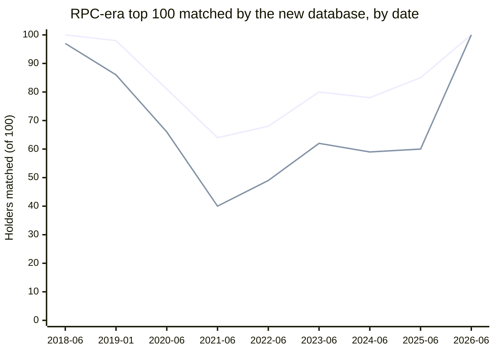
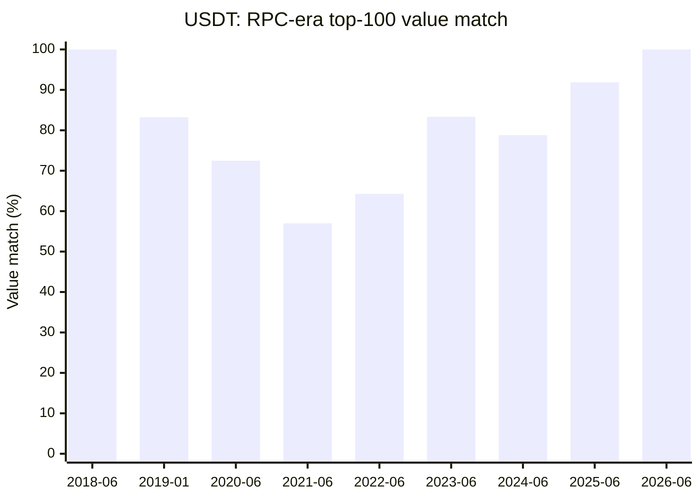
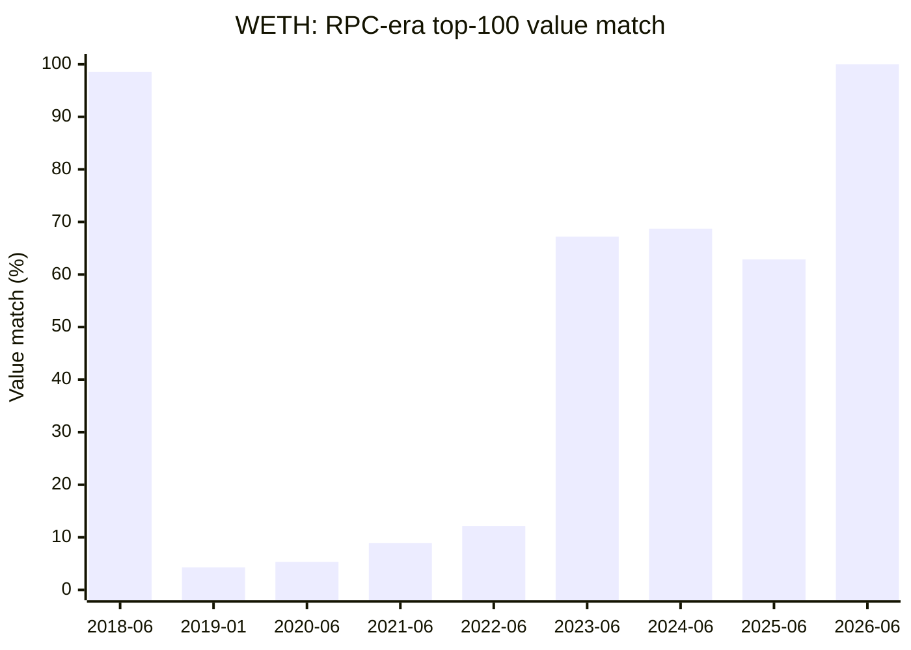
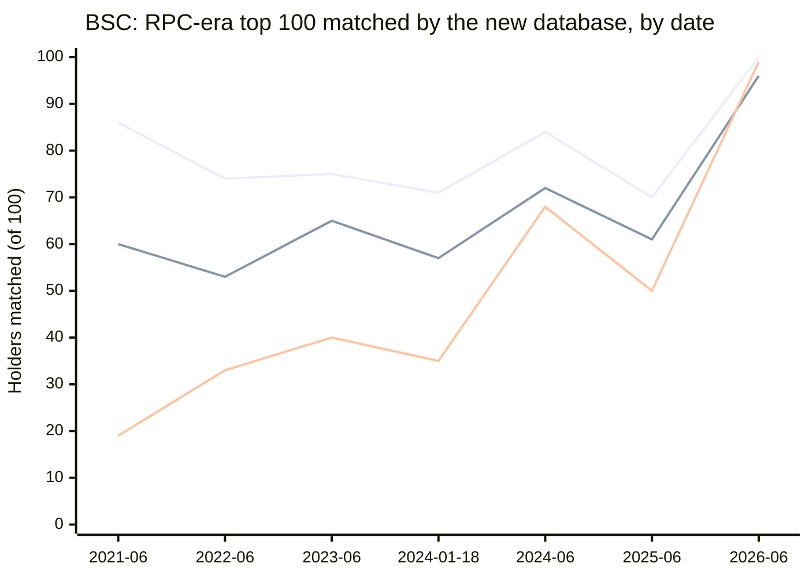

# Top tokens

USDT, USDC and WETH on Ethereum, and USDT, USDC and WBNB on BSC, can be
served from the new databases, top holders included. Every chain's wrapped
native contract has the same native balance in both databases, to the wei.

This page takes a closer look at USDT, USDC and WETH on Ethereum, at USDT,
USDC and WBNB on BSC, and at the wrapped native token of every chain with a
backfilled native database: WETH, WBNB, WPOL and WHYPE.

- **New databases:** `mainnet:evm-balances-erc20@v0.7.4` (cutoff
  26,214,999, 2026-10-17 21:35 UTC), `bsc:evm-balances-erc20@v0.7.4` (cutoff
  128,354,999, compared at the cutoff hour 2026-10-18 11:00 UTC where
  needed) and the native databases of the [native page](quality-native.md).
- **Reference:** the RPC-era `<chain>:evm-balances@v0.3.3`.
- **Queries:** run on 2026-10-19 (Ethereum and wrapped native) and
  2026-10-20 (BSC), read-only, with no RPC or Firehose call. Each analysis
  was rechecked by a second pass, and this page gives the corrected
  results. [Methods](quality-methods.md) has the SQL.

## Summary

| Token | Verdict | Wrong in the new database |
| --- | --- | --- |
| USDT | ✅ Serve from the new database | Zero address (by design), 3 dust holders unresolved |
| USDC | ✅ Serve from the new database | 1 holder, 0.2 USDC |
| WETH | ✅ Serve from the new database | Zero address (by design), 12 holders, 0.488 WETH |
| Wrapped native, 7 chains | ✅ Contract's native balance equal in both databases | None found; the RPC-era holder sums are wrong on BSC and Polygon ([below](#wrapped-native-tokens-on-every-chain)) |
| BSC USDT | ✅ Serve from the new database | None found |
| BSC USDC | ✅ Serve from the new database | None found |
| BSC WBNB | ✅ Serve from the new database | Zero address (by design), 2 holders, 5.127 WBNB |

Legend: ✅ checked and agrees, ⚠️ error found (the cell says where),
🔍 open check, ⏳ waiting.

> [!IMPORTANT]
> **The zero address is never a holder in the new database.** USDT and WETH
> credit transfers to `0x0`, so it holds 39,902.54 USDT and 1,088.92 WETH
> there. The Token API should either take that one row from elsewhere or
> document it.

At the cutoff:

| Token | Comparable holders | Non-zero match | Value match | Top 1,000 |
| --- | ---: | ---: | ---: | ---: |
| USDT | 78,272,145 | 99.990763% | 99.997905% | 1,000 |
| USDC | 36,888,869 | 99.990900% | 99.992018% | 1,000 |
| WETH | 6,648,512 | 99.9919% | 99.99981% | 999 |
| BSC USDT | 249,192,169 | 99.997514% | 99.981871% | 1,000 |
| BSC USDC | 16,023,705 | 99.995803% | 99.982262% | 1,000 |
| BSC WBNB | 12,881,203 | 99.999051% | 99.942989% | 1,000 |

- **USDT, USDC and WETH can be served from the new database**, top holders
  included. Each has at most a dozen wrong holders, and those have small
  balances. Almost every other difference is an RPC-era error. On BSC the
  new database is wrong for no USDT or USDC holder and for 2 WBNB holders.
- **The supplies close.** The sum of the new balances equals each token's
  independent supply, less the zero address and the listed errors. The
  RPC-era's sum over-counts USDT by 901,603.62 USDT on Ethereum and by
  927,691.48 USDT on BSC.
  - USDT: new total = supply minus the zero address, to the unit.
  - USDC: new total = event-log supply + 0.2 USDC.
  - WETH: contract's ETH − holders = zero address + 0.488 WETH + about
    0.001.
  - BSC USDT and BSC USDC: new total = supply from mint and burn events,
    to the wei.
  - BSC WBNB: contract's BNB − holders = zero address + 5.127 WBNB, residual
    0.

> [!NOTE]
> **History is better in the new database.** The RPC-era backfill kept 0.1%
> to 1.2% of an active holder's changes, so its historical top holders are
> often hours stale. The new database's history follows the event log,
> except for WETH in 2018 and 2019.

*RPC-era top 100 holders on the first of each month shown that the new
database matches: first (upper) line USDT, second (lower) line WETH. The
shortfall from 100 is the RPC-era backfill's sparse history, as the
[USDT](#usdt-history) and [WETH](#weth-history) history sections explain.*

## USDT

USDT can be served from the new database, top 1,000 holders included. Apart
from the zero address and 3 dust holders that need RPC, every difference is
an RPC-era error, and the supply closes to the unit.

`0xdac17f958d2ee523a2206206994597c13d831ec7`, 6 decimals.

| Count at the cutoff | Value |
| --- | ---: |
| Comparable | 78,272,145 |
| Match | 78,270,744 (99.998210%) |
| Non-zero comparable / match | 15,167,866 / 15,166,465 (99.990763%) |
| Mismatch: new older / same block / new newer | 3 / 36 / 1,362 |
| Value match (comparable holders, 59% of supply) | 99.997905% |
| After the cutoff | 224,208 |
| Only RPC-era | 11,611,766, all zero |
| Only new: zero / non-zero | 395 / 135 (16,527.61 USDT) |
| Top 10 / 100 / 1,000 | 10 / 100 / 1,000, value 100%, no phantom holder |

### USDT differences

Across all 90,280,237 holders, compared at the cutoff hour (2026-10-17 21:00
UTC, using hourly closes for holders changed after the cutoff), 1,537
differ. The value match is 99.998715%.

| Class | Holders | RPC-era minus new | Wrong side |
| --- | ---: | ---: | --- |
| RPC-era lost the row (new newer) | 1,362 | +872,799.58 USDT | RPC-era |
| RPC-era lost the row (only new) | 135 non-zero | −16,527.61 USDT | RPC-era |
| RPC-era stored the pre-block value (same block) | 36 | +45,331.67 USDT | RPC-era |
| Zero address | 1 | +39,902.54 USDT | new, by design |
| RPC-era wrote 0 with no event (new older) | 3 | −0.02 USDT | needs RPC |

Evidence for each class:

- **Lost the row (new newer):** new minus RPC-era equals the net `Transfer`
  flow between the two rows, for 1,362 of 1,362.
- **Lost the row (only new):** the net flow equals the new balance for all
  530 only-new holders.
- **Pre-block value (same block):** new minus RPC-era equals the holder's one
  transfer in the block, 36 of 36.
- **Wrote 0 with no event (new older):** no transfer of any token touches
  them in between.

The lost rows are mostly in:

- blocks 24,527,334 to 24,527,826 (2026-02-24 14:24 to 16:00 UTC),
- blocks 24,635,701 to 24,635,725 (2026-03-11 around 17:25 UTC),
- block 24,626,677.

The RPC-era has every block there; it wrote no row for these holders. Its
hourly row counts for the busiest holders show more heavy losses in the live
part, which affect history only: 2026-02-09 16:00 to 02-10 02:00, 02-20 19:00
to 20:00, 05-06 15:00, 05-28 07:00, 08-25 21:00 and 09-10 10:00 to 14:00 UTC.

### USDT supply

The new total is exactly the supply minus the zero address's 39,902.544679
USDT. USDT's supply is its initial 100,000 USDT (1e11 units; the deployer's
balance confirms it), plus `Issue`, less `Redeem` and `DestroyedBlackFunds`.
At the cutoff hour that is 88,302,633,055.702652 USDT. The RPC-era total is
the supply plus 901,603.620259 USDT, and the classes above account for the
difference to the unit.

### USDT history

In all 153 differing entries, the new database's last change is later, and
new minus RPC-era equals the net `Transfer` flow in between. The RPC-era's
backfill kept about one row per holder per write batch, so its closes are
up to 2,176 blocks stale. A 1-in-2,000 random holder sample differs in at
most one holder per date.

*Top-100 value match at 00:00 UTC on each date; the exact figures are in the
table below.*

Top 100 holders at 00:00 UTC on each date, from hourly bars:

| Date | RPC-era top 100 matched | Top 10 matched | Top-100 value match |
| --- | ---: | ---: | ---: |
| 2018-06-01 | 100 | 10 | 100.00% |
| 2019-01-01 | 98 | 8 | 83.25% |
| 2020-06-01 | 81 | 5 | 72.48% |
| 2021-06-01 | 64 | 4 | 56.98% |
| 2022-06-01 | 68 | 6 | 64.27% |
| 2023-06-01 | 80 | 9 | 83.34% |
| 2024-06-01 | 78 | 8 | 78.81% |
| 2025-06-01 | 85 | 8 | 91.88% |
| 2026-06-01 | 100 | 10 | 100.00% |

## USDC

USDC can be served from the new database, top 1,000 holders included. One new
row is stale by 0.2 USDC; every other difference is an RPC-era error.

`0xa0b86991c6218b36c1d19d4a2e9eb0ce3606eb48`, 6 decimals. Recounted on
2026-10-19 with `argMax` instead of `FINAL`:

| Count at the cutoff | Value |
| --- | ---: |
| Comparable | 36,888,869 |
| Match | 36,888,050 (99.997780%) |
| Non-zero comparable / match | 8,999,692 / 8,998,873 (99.990900%) |
| Mismatch: new older / same block / new newer | 1 / 11 / 807 |
| Value match (comparable holders, 32.8B of 48.0B USDC) | 99.992018% |
| After the cutoff | 185,621 |
| Only RPC-era | 8,170,188, all zero |
| Only new: zero / non-zero | 237 / 97 (18,548.46 USDC) |
| Top 10 / 100 / 1,000 (run of 2026-10-18) | 10 / 100 / 1,000, no phantom holder |

### USDC differences

| Class | Holders | Wrong side |
| --- | ---: | --- |
| RPC-era lost the row (new newer) | 807 | RPC-era |
| RPC-era lost the row (only new) | 334 (97 non-zero) | RPC-era |
| RPC-era stored the pre-block value (same block) | 11 | RPC-era |
| New row stale (new older) | 1 | new |

Evidence for each class:

- **Lost the row (new newer):** the net flow between the rows equals the
  difference for 807 of 807: 667 in blocks 24,527,337 to 24,527,814, 47 in
  24,635,700 to 24,635,725, 93 elsewhere in 24,503,379 to 24,632,118.
- **Lost the row (only new):** the net flow since 24,420,000 equals the new
  balance for all 334.
- **Pre-block value (same block):** blocks 23,220,071 to 23,338,667, as for
  USDT.
- **New row stale (new older):** `0x9999fa87f5a1d1c64e7c709838b92006ab0cc1ad`:
  0.2 USDC since 18,963,384; two later transfers net −0.2.

119,894 holders have an RPC-era row only after the cutoff and no new row
(19,424 non-zero). The 31,419 of them with bars before the cutoff hour were
all zero there, so none hides a balance at the cutoff.

### USDC supply

The new total is 0.2 USDC above the event-log supply: the stale holder above.
`Transfer` from `0x0` minus `Transfer` to `0x0` gives
48,049,938,040.151212 USDC, once duplicate rows are removed (below). The new
total is 48,049,938,040.351212 USDC.

### Blacklist bit

No balance in either database reaches 2^128. FiatToken sets bit 255 of a
blacklisted holder's word ([limits](../erc20/balances/README.md#limits)). The
largest balance is 4,192,783,701.439372 USDC, at
`0x37305b1cd40574e4c5ce33f8e8306be057fd7341`.

## WETH

WETH can be served from the new database, top holders included. Besides the
zero address, it is wrong for 12 holders credited only by `Deposit` in 2018
and 2019, by 0.488 WETH in all. The other differences are RPC-era errors or
need RPC.

`0xc02aaa39b223fe8d0a0e5c4f27ead9083c756cc2`, WETH9.

| Count at the cutoff | Value |
| --- | ---: |
| Comparable | 6,648,512 |
| Match | 6,648,245 (99.9960%) |
| Non-zero comparable / match | 3,316,317 / 3,316,050 (99.9919%) |
| Mismatch: new older / same block / new newer | 14 / 253 / 0 |
| Value match (comparable holders) | 745,207.378 of 745,208.778 WETH (99.99981%) |
| After the cutoff | 27,526; 55,712 of 55,714 changed since the cutoff hour are equal at it |
| Only RPC-era: zero / non-zero | 19,223,776 / 11 |
| Only new | 0 |
| Top 10 / 100 / 1,000 | 10 / 100 / 999 (the zero address, rank 130), value 99.946% |

### WETH differences

| Class | Holders | Amount (WETH) | Wrong side |
| --- | ---: | ---: | --- |
| Zero address | 1 | 1,088.924170800877388827 | new, by design |
| Deposit-only credit | 12 (11 only RPC-era, 1 new older) | 0.488013932 | new |
| Dust stored before the transfer | 254 | 0.000604 | RPC-era |
| RPC-era wrote 0 | 13 | 0.000176 | RPC-era likely, needs RPC |

- **Deposit-only credit:** credited only by `Deposit`, in a block whose only
  WETH events are deposits (2018-04 to 2019-08).
- **Dust stored before the transfer:** blocks 23,307,096 and 23,296,064.
- **RPC-era wrote 0:** on 2026-02-24, 14:28 to 15:54 UTC.

The 12 deposit-only holders never moved again. Since v0.7.4 a `Deposit`
frame without a `Transfer` counts only when it passes the backed-deposit
check, and these frames evidently fail it. Which condition fails needs the
Extended blocks. The dust transaction at 23,307,096
(`0xd22b359d7d8661fcd7fb4a966e8f5ec610c0376e345983ea272aca2fddc579df`) sends
1e11 wei to 635 addresses; the RPC-era stored the pre-transfer balance for
268 of them.

### WETH supply

WETH9's `totalSupply()` is its own ETH balance. The contract's ETH balance in
the native database minus the sum of the new WETH balances is
1,089.413184732877412499 ETH, both at block 26,197,999 and at the cutoff
hour, identical to the wei. That is:

- the zero address,
- the 12 missed deposits,
- a residual of 0.000985 to 0.001 ETH, depending on which value of the zero
  address is right. The residual fits ETH sent to the contract without a
  deposit, but it was not measured.

For the RPC-era database the gap is 0.000572 ETH.

### WETH history

The new database's history follows the `Transfer`, `Deposit` and
`Withdrawal` events, except in 2018 and 2019. On 2019-08-19 it skipped 32 of
137 deposit-only holder-blocks, so 32 of the 759 holders that moved that day
carried a wrong change (226.02 WETH) until their next write. In the windows
tested in 2021, 2023 and 2026 it matches the events for every holder. The
RPC-era's backfilled history matches them for 64.3% (2021) and 31.5% (2023)
of the holders that moved.

*Top-100 value match on each date; the exact figures are in the table
below.*

| Date | RPC-era top 100 matched | Top 10 matched | Top-100 value match |
| --- | ---: | ---: | ---: |
| 2018-06-01 | 97 | 9 | 98.53% |
| 2019-01-01 | 86 | 6 | 4.29% |
| 2020-06-01 | 66 | 3 | 5.31% |
| 2021-06-01 | 40 | 1 | 8.92% |
| 2022-06-01 | 49 | 1 | 12.17% |
| 2023-06-01 | 62 | 5 | 67.22% |
| 2024-06-01 | 59 | 6 | 68.72% |
| 2025-06-01 | 60 | 5 | 62.87% |
| 2026-06-01 | 100 | 10 | 100.00% |

In every differing pair, the RPC-era's last change before the hour is
earlier than the new database's. Where both last changes are at the same
block, the values are equal. Very active holders have 3 to 5 hourly bars a
day in the RPC-era's backfill, against 23 or 24 in the new database.

## BSC USDT, USDC and WBNB

`bsc:evm-balances-erc20@v0.7.4` against `bsc:evm-balances@v0.3.3`, at block
128,354,999. Holders changed after the cutoff are compared at the cutoff
hour, 2026-10-18 11:00 UTC, from hourly bars. The RPC-era database is live,
so its counts drift by a few thousand holders between passes; the figures
below come from one pass each.

> [!NOTE]
> On BSC the new database is wrong for **no** USDT or USDC holder. Every
> difference is a block the RPC-era never wrote (the 1,629 blocks of
> 2024-01-18 and 434 live-sink blocks, see
> [native quality](quality-native.md#errors-in-the-rpc-era-databases)) or
> one of its stale reads. For WBNB, 2 holders whose only credit is a 2020
> `Deposit` are missing (5.127 WBNB).

| | BSC USDT | BSC USDC | BSC WBNB |
| --- | ---: | ---: | ---: |
| Contract | `0x55d39832…` | `0x8ac76a51…` | `0xbb4cdb9c…` |
| Comparable holders | 249,192,169 | 16,023,705 | 12,881,203 |
| Holder match | 99.999207% | 99.998727% | 99.999620% |
| Non-zero match | 99.997514% | 99.995803% | 99.999051% |
| Mismatch: new older / same block / new newer | 0 / 32 / 1,943 | 0 / 2 / 202 | 0 / 0 / 49 |
| Only RPC-era, non-zero | 0 | 0 | 2 (5.127 WBNB) |
| Only new, non-zero | 283 | 32 | 6 |
| Top 10 / 100 / 1,000 | 10 / 100 / 1,000 | 10 / 100 / 1,000 | 10 / 100 / 1,000 |
| Wrong in the new database | none found | none found | 2 holders + zero address |

The contracts are BSC-USD `0x55d398326f99059ff775485246999027b3197955`,
Binance-Peg USDC `0x8ac76a51cc950d9822d68b83fe1ad97b32cd580d` (both 18
decimals) and WBNB `0xbb4cdb9cbd36b01bd1cbaebf2de08d9173bc095c`. No new
holder top list has a phantom holder. For each token, comparable + after +
only new equals the new database's holder count (USDT 251,492,036, USDC
16,454,260, WBNB 12,986,087).

### BSC USDT

| Class | Holders | Absolute difference | Wrong side |
| --- | ---: | ---: | --- |
| New row in the RPC-era's unwritten blocks of 2024-01-18 (new newer) | 1,343 | 780,911.88 USDT | RPC-era |
| New row in the RPC-era's skipped live blocks, 81.8M to 100.9M | 600 | 150,690.70 USDT | RPC-era |
| Only in the new database, funded in those blocks | 283 non-zero, 770 zero | 4,079.47 USDT | RPC-era |
| Same block, stale RPC-era read (84,599,556 to 84,599,582) | 32 | 1,739.08 USDT | RPC-era |
| Changed after the hour, earlier change in the 2024-01-18 blocks | 2 | 516.00 USDT | RPC-era |

- **Every difference is settled by events.** For all 3,028 differences at
  the cutoff, new minus RPC-era equals the deduplicated `Transfer` flow. 30
  of the 32 same-block rows hold the balance from before the block; the
  other 2 are reads at least 80 blocks stale.
- **Value.** The comparable holders match 99.981871% of their RPC-era value
  (5,144,773,338.20 of 5,145,706,221.81 USDT). They hold only about 56% of
  the supply: holders changed after the cutoff hold 4,040,212,813.20 USDT.
  Across all 381,769,798 holders at the cutoff hour, 2,260 differ, all
  RPC-era errors, and 99.98984% of the value matches.
- **Supply.** 58 mints (10,984,999,340.73 USDT) less 638 burns
  (1,800,007,481.209740225883276351 USDT) give 9,184,991,859.520259774116723649
  USDT, exactly the new database's sum. The RPC-era sum at the hour is that
  plus 927,691.484429712169278150 USDT, which the classes above account for
  exactly.
- **History.** At 10 past hours from 2020-12-01 to 2026-06-01, all 395
  differing top-100 entries and 24 random-sample differences follow the
  events in the new database. Before 2026, only 38% to 70% of the RPC-era's
  top-100 value sits in exactly matching holders (96.6% on 2026-06-01); the
  value-weighted error is 0.00003% to 4.4%.
- **Zero rows.** The 129,337,432 RPC-era-only holders are all zero. None of
  1,276 sampled was ever sender or recipient of a non-zero USDT `Transfer`.

### BSC USDC

| Class | Holders | Absolute difference | Wrong side |
| --- | ---: | ---: | --- |
| New row in the RPC-era's unwritten blocks of 2024-01-18 (new newer) | 169 | 93,095.01 USDC | RPC-era |
| New row in the RPC-era's skipped live blocks, 83.66M to 100.40M | 33 | 10,593.19 USDC | RPC-era |
| Only in the new database, funded in those blocks | 32 non-zero, 49 zero | 2,287.72 USDC | RPC-era |
| Same block, stale RPC-era read (84,599,556 to 84,599,557) | 2 | 0.000128 USDC | RPC-era |

- **Value.** The comparable holders match 99.982262% of their value and hold
  36.78% of the new total. All 512,344 holders changed after the cutoff are
  equal at the cutoff hour, so with them 99.993499% of the value matches.
- **Supply.** 50 mints (3,039,000,000 USDC) less 26 burns
  (1,450,000,122.560196 USDC) give 1,588,999,877.439804 USDC, the new
  database's total to the wei. The RPC-era total is 101,232.794738 USDC
  higher: the sum of its 285 per-holder errors, to the wei.
- **History.** At 8 past dates from 2021-06-01 to 2026-06-01, 14 to 30 of
  the RPC-era's top 100 differ before 2026 and none on 2026-06-01. All 244
  differences tested against events show the RPC-era stale.
- **Completeness.** In one shard of eight, every one of 2,054,097 recipients
  and 1,919,448 senders of a USDC `Transfer` has a new row.

### BSC WBNB

| Class | Holders | Amount | Wrong side |
| --- | ---: | ---: | --- |
| RPC-era stale in its unwritten blocks of 2024-01-18 | 32 new newer, 5 only new | 233.99 + 0.37 WBNB | RPC-era |
| RPC-era stale in its skipped live blocks, 86.4M to 100.0M | 17 new newer, 1 only new | 16.47 WBNB | RPC-era |
| Credited only by a `Deposit`, in a block with no WBNB `Transfer` (2020) | 2 | 5.127 WBNB | new |
| Zero address | 1 | 73.262380589262592219 WBNB | new, by design |

- **The 2 missing holders** were credited 0.127 WBNB at block 1,180,462 and
  5 WBNB at block 2,415,928, and never moved again: the BSC counterpart of
  the 12 [WETH](#weth) holders. Since v0.7.4 such a `Deposit` counts only
  when it passes the backed-deposit check, and these evidently fail it.
  From 2020-10 to 2021-02 the new database skipped at least 532 deposit-only
  holder-blocks; later writes healed all but these 2. It missed none of the
  44,836 deposit- or withdrawal-only holder-blocks after 2021-02, and no
  withdrawal ever.
- **Supply.** WBNB's native balance minus the new holder sum is
  78.389380589262592219 WBNB, the zero address plus the 2 missing deposits,
  with residual 0. It is the same at three points: the native database's
  cutoff hour, its cutoff block and the ERC-20 cutoff hour. The RPC-era
  holder sum is 250.083918561925075354 WBNB above the native balance: 49
  stale holders (+250.454312722015743368) less 6 never credited
  (0.370394160090668014), [below](#wrapped-native-tokens-on-every-chain).
- **Value.** The comparable holders match 99.942989% of their value. Holders
  changed after the cutoff hold 71.75% of the new total, and all are equal
  at the cutoff hour except the zero address.
- **History.** In ten one-hour windows from 2020 to 2026, the new database's
  hourly change equals the deduplicated event flow for every one of 32,448
  holders that moved; the RPC-era's matches for 3% to 46% before 2026. The
  RPC-era's top 100 matched only 17 to 68 holders at past dates before 2026.

*RPC-era top 100 holders that the new database matches, at 00:00 UTC on
the first of each month shown (18:00 UTC on 2024-01-18): top line USDC,
middle line USDT, bottom line WBNB (all three near 100 in 2026). As on
Ethereum, the shortfall is the RPC-era backfill's sparse history; the live
part (2026-06) nearly matches.*

## Wrapped native tokens on every chain

On all seven chains the contract's native balance is the same to the wei in
both databases. The RPC-era's holder sums are wrong on BSC and Polygon.

Every RPC-era row of these contracts is after the cutoff, so they are
compared at the start of the cutoff's hour (H) from hourly bars.

| Chain | Token | Contract | RPC-era holder sum |
| --- | --- | --- | --- |
| Ethereum | WETH | `0xc02aaa39b223fe8d0a0e5c4f27ead9083c756cc2` | ✅ small positive gap |
| BSC | WBNB | `0xbb4cdb9cbd36b01bd1cbaebf2de08d9173bc095c` | ⚠️ stale holders |
| Base | WETH | `0x4200000000000000000000000000000000000006` | ✅ equal |
| Optimism | WETH | `0x4200000000000000000000000000000000000006` | ✅ equal to 1 wei |
| Unichain | WETH | `0x4200000000000000000000000000000000000006` | ✅ equal |
| Polygon | WPOL | `0x0d500b1d8e8ef31e21c99d1db9a6444d3adf1270` | ⚠️ excess; 🔍 holders not identified |
| HyperEVM | WHYPE | `0x5555555555555555555555555555555555555555` | ✅ small positive gap (1 WHYPE step, block not isolated) |

| Chain | Contract's native balance at H, both databases | Native balance − RPC-era holder sum |
| --- | ---: | ---: |
| Ethereum | 2,218,037.701258277986841060 | 0.000572092148695827 |
| BSC | 1,547,839.324610474773389070 | −250.083918561925075354 |
| Base | 279,987.532918005106225555 | 0 |
| Optimism | 19,176.571910300465429016 | 1 wei |
| Unichain | 2,759.006521949911073920 | 0 |
| Polygon | 160,677,221.843449373848996516 | −42.713585340815414220 |
| HyperEVM | 3,385,289.581273615125155108 | 1.000000000000000000 |

- **Native balances agree.** On all seven chains the contract's native
  balance at H is the same to the wei in both databases. Each new row at the
  cutoff also equals the close at H plus the net native flow to the cutoff
  in `<chain>:evm-transfers@v0.3.3`.
- **Native history agrees.** On six chains, no hourly bar ending at the same
  block differs. On Ethereum, 274 do, all in the RPC-era's first live weeks
  (2026-02-10 to 2026-02-23), and 272 of them hold the pre-block balance
  ([native](quality-native.md#errors-in-the-rpc-era-databases)).
- **A holder sum cannot exceed the contract's balance**, since every WETH9
  token is backed by native currency. So a negative gap is an RPC-era
  error:
  - BSC: 73 WBNB holders whose last change fell in the 2,063 blocks the
    RPC-era never wrote are stale. Their missed changes sum to
    −250.083920231925075354 WBNB, which leaves +0.00000167 WBNB. For the five
    largest (72% of the amount), the superseded
    `bsc:evm-balances-erc20@v0.7.3`, also built from Extended blocks, holds
    exactly the RPC-era value minus the missed change. The BSC ERC-20
    comparison of 2026-10-20 accounts for the same 250.083918561925075354
    WBNB as 49 stale holders and 6 holders the RPC-era never credited
    ([BSC WBNB](#bsc-wbnb)).
  - Polygon: the excess is the same to the wei since at least 2026-03-01,
    13 days after the RPC-era's live start. It is not missing blocks, the
    zero address or a holder left stale in the live part. The holders are not
    identified yet; a rebuild from `polygon:evm-transfers@v0.3.3` with
    duplicate rows removed should find them without RPC.
- **Small positive gaps** fit native currency sent without a deposit:
  0.000572 ETH on Ethereum, and exactly 1 WHYPE on HyperEVM, a step visible
  in both databases whose block was not isolated. On Base, Optimism and
  Unichain the sum equals the balance, to 1 wei.
- **RPC-era hourly closes lag.** In its live part, the RPC-era's hourly
  close of the wrapped contract ends before the hour's last change in 95% of
  the hours on BSC (median 11 blocks) and 82% on Base (median 6 blocks). The
  comparisons at H above happen to be free of this lag.
- **New ERC-20 database on Ethereum.** WETH holders sum to
  1,089.413184732877412499 ETH below the contract's balance (the zero address
  and the missed deposits, [above](#weth)). The top 20 holders are equal in
  both ERC-20 databases.

> [!WARNING]
> The transfer databases used as evidence here have duplicate rows and other
> gaps; see [Methods](quality-methods.md#evidence-databases) before summing
> them.
